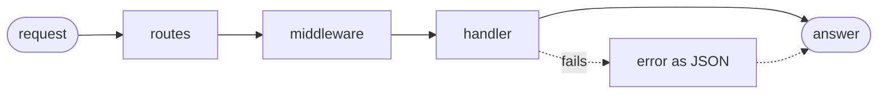

# goose-rest

A REST framework for [Goose](https://github.com/aardappel/goose), on
[goose-http](https://github.com/kaitk/goose-http): Actix's model, changed where Goose
differs, at no cost over a hand-written router wherever the language allows. An optional
generator writes types, JSON readers and writers, and a router from an OpenAPI document.

Early: this is the API goose-rest means to keep, and its tutorial and examples are
written in it, but it isn't settled. Expect changes between tags, mostly in names and
details, while some of its costs over goose-http are still being worked on.

[Tutorial](docs/tutorial.md) · [Reference](docs/reference.md) ·
[Generator](docs/generator.md) · [Benchmarks](docs/benchmarks.md) ·
[Architecture](docs/architecture/README.md) · [Development](docs/development.md) ·
[Changelog](CHANGELOG.md)

## Status

goose-rest builds wherever goose-http does: Linux, macOS, and Windows. Its examples also
pass their tests on arm64 Linux.

🟢 works · 🟡 partial · ⚪ not yet · 🔴 out of scope

| | Feature | Notes |
|---|---|---|
| 🟢 | Routes | Path parameters, 404, 405 with `Allow`, and `OPTIONS`; guards are `if` conditions ([reference](docs/reference.md#context-and-routes)). |
| 🟢 | Scopes | Prefixes, each with its own middleware. |
| 🟢 | Extractors | Path, query, header, and cookie parameters, a JSON body, and a program's own types ([reference](docs/reference.md#extractors)). |
| 🟡 | Forms | Whole form bodies through goose-http's `http::form_value`; no extractor, and no multipart. |
| 🟢 | State | The worker's state in `cx.app`, and the request's in `cx.state`. |
| 🟢 | Middleware | Blocks inlined into the handler; which exist is [below](#middleware). |
| 🟢 | Errors | JSON with a code, in a shape your program can replace ([reference](docs/reference.md#errors)). |
| 🟢 | Async work | Ask a thread of the program's, resume with its reply, and skip the work for a client that has gone. |
| 🟢 | Testing | `rest::serve_one` answers a request's bytes without a socket ([reference](docs/reference.md#testing)). |
| 🟢 | OpenAPI in | Types, validating readers, writers, and a router from OpenAPI 3.1, written as JSON or in TypeScript ([generator](docs/generator.md)). |
| ⚪ | OpenAPI out | A document from the routes, as Elysia's plugin writes. Planned, later. |
| ⚪ | Static files, streaming | Not in goose-rest yet; goose-http serves files and streams. |
| 🔴 | WebSocket | Out of scope, as in goose-http. |

### Middleware

| | Middleware | Notes |
|---|---|---|
| 🟢 | CORS | Preflights, listed origins, and credentials. |
| 🟢 | Bearer tokens | 401 with `WWW-Authenticate`, and the token for your check. |
| 🟢 | Server-Timing and access log | One middleware, or the timing alone. |
| 🟢 | Your own | Any `inline fn` that takes a block ([reference](docs/reference.md#middleware)). |
| ⚪ | JWT | No verifier yet; the bearer middleware hands your own check the token. |
| ⚪ | Sessions | No session store yet; read the cookie with `rest::cookie`. |
| ⚪ | Compression | No middleware yet; goose-http compresses responses. |
| ⚪ | Rate limiting | No limiter yet; goose-http's limits and timeouts per connection apply. |
| ⚪ | Default headers | No middleware yet; add fields to every response through `cx.out.common` ([goose-http](https://github.com/kaitk/goose-http/blob/main/docs/api.md#handler)). |

## Quick start

Install Goose [`v2026.1`](https://github.com/aardappel/goose/releases/tag/v2026.1): unpack
the archive for your platform and put its directory on `PATH`
([Goose's install notes](https://github.com/aardappel/goose#install-a-release)). Building
a program also needs a C compiler and, on Linux, liburing:

- **Linux:** gcc or clang, with `libc6-dev` and `liburing-dev` (Debian, Ubuntu).
- **macOS:** the Xcode command line tools (`xcode-select --install`).
- **Windows:** the Visual Studio 2022 or later Build Tools, with the C++ workload.

Save this as `hello.goose`:

```goose
import http from "github.com/kaitk/goose-http@v0.3.1";
import rest from "github.com/kaitk/goose-rest@v0.0.1";

fn handle(cx) {
    rest::routes(cx) { cx =>
        if rest::on(cx, "GET", "/hello/:name") {
            rest::route(cx) { rest::text(cx, 200, str("Hello, ", rest::param(cx, "name"))); };
        } else {
            rest::otherwise(cx);
        }
    };
}

thread_fn worker(cfg: http::Config) {
    let e = rest::serve(cfg) { cx => handle(cx) };
    http::report(e);
}

fn main() {
    let cfg = http::Config { port: 8080, .. };
    var ids: i64[>..] = [];
    for i in http::worker_count(cfg) { ids.push(thread_spawn(worker, cfg)); }
    for id in ids { thread_wait(id); }
}
```

Build it and run it, then open <http://localhost:8080/hello/goose>:

```sh
goose build hello.goose
./hello
```

*Note: a server with workers needs `goose build`: `goose hello.goose` runs through
TinyCC, which can't start threads.*

**With a schema**, describe the API in OpenAPI 3.1, as JSON or in
[TypeScript](docs/generator.md#write-it-in-typescript), and generate its types and router
([how](docs/generator.md#run-it)). `api::dispatch(cx)` then takes the place of the
routes, and calls a handler of yours per operation with typed, validated parameters and
body: [tutorial, step 6](docs/tutorial.md#6-the-whole-api-from-a-schema).

The [tutorial](docs/tutorial.md) builds a projects API step by step. The examples, each
built and requested by the tests:

| Example | What it shows |
|---|---|
| [`plain/`](examples/plain/main.goose) | Without a schema: routes, scopes, extractors, middleware, and a 4 MB upload beside the 1 MB default |
| [`schema/`](examples/schema/) | From `api.json`: generated types and router, hand-written handlers, and a 2 MB route by `x-body-limit` |
| [`waiting/`](examples/waiting/main.goose) | Routes that ask a database thread and resume when it replies, with replies larger than a message |
| [`device/`](examples/device/) | A board's API: sysfs readings, bounded settings, a firmware upload, a bearer token, and CORS, on one worker |

## Concepts



- **Routes are code.** Goose has no function values to keep in a table, so a route is an
  `if` that matches a method and a path, and a schema's generated router is a `match`.
  What no route matches gets 404, 405, or an `OPTIONS` answer
  ([routes](docs/reference.md#context-and-routes)).
- **One context.** Every call takes `cx`: the request, the response being written, the
  worker's state, and the request's own.
- **Middleware is a block** around the routes it applies to, compiled into the handler,
  so a layer costs no call ([middleware](docs/reference.md#middleware)).
- **Errors return to the route.** A failure anywhere below a route ends it with a JSON
  error, in a shape your program can replace ([errors](docs/reference.md#errors)).
- **Workers share nothing**, as in
  [goose-http](https://github.com/kaitk/goose-http#concepts). A route that needs another
  thread asks it by
  [mail](https://github.com/kaitk/goose-http/blob/main/docs/patterns.md#mail-between-threads),
  and resumes when the reply comes
  ([waiting](docs/architecture/README.md#waiting-on-another-thread)).

Where and why goose-rest differs from Actix:
[architecture](docs/architecture/README.md#actix-and-where-goose-rest-differs).

## Benchmarks

goose-rest `b1226e4`, goose-http `v0.3.1`, and Goose `bc3c1f1` on a Ryzen 7 5800X3D
(WSL2), 4 workers per server, on the io_uring loop.
[All results, the method, and the losses](docs/benchmarks.md).

Against goose-http's REST server, which serves the same routes without a framework:

| Workload | goose-rest | goose-http alone | |
|---|---:|---:|---|
| [A](docs/benchmarks.md#the-tiers): HttpArena's items, 0.2 KB | 585k req/s | 598k | 2.2% behind |
| [C](docs/benchmarks.md#the-tiers): records up to 728 KB | 53.4k req/s | 62.4k | 14% behind |
| C, templates | 142k req/s | 147k | 3.1% behind |
| [F](docs/benchmarks.md#tier-f): `GET /id/{id}?name=` | 504k req/s | 509k | 1.1% behind |
| [M](docs/benchmarks.md#tier-m): A + CORS, bearer, Server-Timing | 489k req/s | | 15% below A |
| [R](docs/benchmarks.md#tier-r): 203 routes, generated | 458k req/s | | 41% over an if chain |

Against Rust and Zig frameworks: to be measured. Meanwhile, goose-http's
[REST APIs](https://github.com/kaitk/goose-http#rest-apis) compare the layer underneath
with xitca-web, dusty, hyper, and tokio.

## Name

goose-rest is a working name. The repository may be renamed before a stable release,
and the import path, `github.com/kaitk/goose-rest`, with it.

## Credits

The runtime takes three ideas from [actix-web](https://github.com/actix/actix-web):

- An `App` of scopes and routes.
- Extractors chosen by type.
- Middleware around a group of routes.

The generator takes three from Elysia 2, the `kiana` branch of
[Elysia](https://github.com/elysiajs/elysia), read at `c91f61f` (2026-10-11):

- One composed handler per route, with only the hooks it has and the request parts it
  reads.
- Validators inline.
- A response writer that copies only declared fields.

Goose's compiler does at build time what Elysia generates at run time or in its AOT build
([architecture](docs/architecture/README.md#the-generator)).
