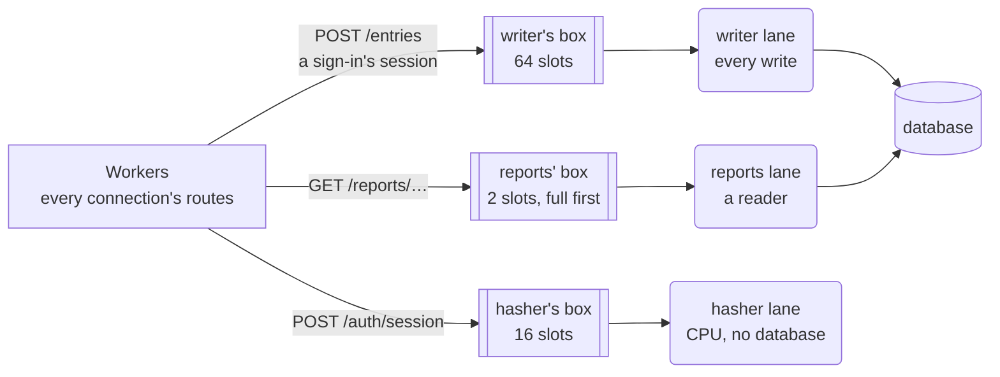

# 6. Lanes and jobs

A *worker* is the thread that takes requests and runs their routes. A server runs one
per core by default, and each serves thousands of connections, one call at a time
([State](../tutorial/08-state.md)). So a worker must not stop: not to wait for the
database, and not to compute for long. That work goes to a lane, as a job:

- A **lane** is a thread of the program, or several threads that run the same jobs,
  for one kind of slow work: writing to the database, reading for reports, hashing
  passwords. Each thread takes its jobs from its **box**, a queue with a fixed number of
  slots.
- A **job** is one use case, such as "create this entry". A route sends it to a lane
  with `rest::ask`, as a small message. The worker serves its other connections until
  the reply comes back. On the lane, a plain function runs the job from start to end,
  in one transaction ([Work that waits](../tutorial/11-waiting.md)).

[Concepts and naming](concepts.md#11-the-concepts) gives their equivalents in other frameworks.

The code on this page is from [`lanes/`](lanes/), a slice of the time-tracking API with
three domains: `entries`, `reports`, and `auth`. Its lanes keep their data in memory in
place of a database.

## 6.1 A lane for each kind of slow work

Split slow work by the resource it occupies: the database's one write connection,
a read connection, or a CPU core. Give each kind a lane of its own, named for what it
does. The program has three lanes, with one thread each:

| Lane | What it does | Its jobs | Box |
|---|---|---|---|
| `writer` | Runs every write to the database, one at a time | `create_entry`, `open_session` | 64 slots |
| `reports` | Reads the database for reports, and sums what it reads | `total_entries` | 2 slots |
| `hasher` | Checks passwords: CPU work, with no database | `verify_password` | 16 slots |



A job then waits only behind jobs of its own kind. A slow report holds a reader, not the
writer, so entries can still be written. A password check occupies the hasher without
holding up the database. A full box refuses a job at once with 503, while the other
boxes still take theirs.

The program's database stands in for one over the
network, where each lane's thread holds its own connection. With embedded SQLite, a
short query runs in the route instead, as short CPU work does
([Long CPU work goes to a lane](#63-long-cpu-work-goes-to-a-lane)), and a lane takes only
what runs long, such as a report.

A lane runs jobs from any domain, and a domain's jobs may run on several lanes: `auth`'s
`verify_password` runs on the hasher, and its `open_session` on the writer. A job's
function is in its domain, beside the route that asks for it
([Structuring a route that waits](#653-structuring-a-route-that-waits)).

## 6.2 How many jobs a box holds

Size a box by how long its lane's jobs take. A route waits for its reply up to a time
limit, 5 seconds by default
([504 for a late reply](../tutorial/13-limits.md#504-for-a-late-reply)). Give the box
only enough slots for jobs the lane can finish within that limit. From
[`lanes/main.goose`](lanes/main.goose):

```rust
// A box holds the jobs its lane finishes within a route's time limit, 5
// seconds by default, in a power of two of at least 2 slots.
// A write takes a millisecond or so: 64 queued wait under a tenth of a second.
let WRITER_SLOTS: i32 = 64;
// A report can take a second or more, and it's the work to refuse first.
let REPORTS_SLOTS: i32 = 2;
// A password hash takes about 50 ms: 16 queued wait under a second.
let HASHER_SLOTS: i32 = 16;
```

A job queued beyond what its lane can finish in time starts after its client has
already received a 504, so the work is wasted. Refusing it at once instead gives the
client a 503, and a chance to try again later. To run more jobs at once, give the
lane more threads, each with its own box, rather than make one box larger
([503 for a full box](../tutorial/13-limits.md#503-for-a-full-box)).

<details>
<summary>How <code>main.goose</code> starts the lanes</summary>

`main` opens each lane with `rest::lane_open`, a box per thread, with slots of 256 bytes
to fit the largest job a route sends. It gives the workers the lanes in `App`, which a
route reads as `cx.app.writer`, and starts each lane's threads. At shutdown, it stops
each lane with `rest::lane_stop` and waits for its threads:

```rust
    let place = http::place_load();
    // The code bounds each lane, and a placement file chooses within the
    // bounds. One writer, which needs nothing written: max is threads unless
    // written. Reports may grow to 4 threads, and the hasher to 2.
    let app = App {
        writer: rest::lane_open(place, rest::LaneConfig { role: "writer", slots: WRITER_SLOTS, .. }),
        reports: rest::lane_open(place, rest::LaneConfig { role: "reports", max: 4, slots: REPORTS_SLOTS, .. }),
        hasher: rest::lane_open(place, rest::LaneConfig { role: "hasher", max: 2, slots: HASHER_SLOTS, .. }),
    };
    var lanes: i64[>..] = [];
    for b, i in app.writer.boxes { lanes.push(thread_spawn(writer, b, rest::lane_seat(place, app.writer, i))); }
    for b, i in app.reports.boxes { lanes.push(thread_spawn(reports, b, rest::lane_seat(place, app.reports, i))); }
    for b, i in app.hasher.boxes { lanes.push(thread_spawn(hasher, b, rest::lane_seat(place, app.hasher, i))); }
    let cfg = http::Config { port: port as i32, workers: 1, place: place, mail_slots: 64, max_waiting: 1024, .. };
    var ids: i64[>..] = [];
    for i in http::worker_count(cfg) { ids.push(thread_spawn(worker, cfg, app)); }
    for id in ids { thread_wait(id); }
    // A flag in each box, not a message: a full box can't refuse it.
    rest::lane_stop(app.writer);
    rest::lane_stop(app.reports);
    rest::lane_stop(app.hasher);
    for id in lanes { thread_wait(id); }
```

</details>

<details>
<summary>What a lane's thread runs</summary>

A lane's thread takes its seat, then takes each job from its box by its tag in
`rest::lane`, runs the job's function, and replies. The writer:

```rust
// The writer lane, one thread: the database's one writer. It owns the entries
// and the sessions, and runs every job that writes, one at a time.
thread_fn writer(box: http::Box, at: http::Seat) {
    // First, before the thread touches memory of its own.
    http::take_seat(at);
    var all: entries::Entry[>..] = [];
    var sessions: auth::Session[>..] = [];
    // Each job in the box, in order, told apart by its tag, until main stops
    // the box.
    rest::lane(box) { tag, bytes =>
        if tag == CREATE_ENTRY {
            // The job, and where reply_value sends the reply.
            let a, ok = rest::asked<entries::CreateJob>(bytes);
            if ok { rest::reply_value(a, entries::create_entry(all, a.job)); }
        } else if tag == OPEN_SESSION {
            let a, ok = rest::asked<auth::OpenJob>(bytes);
            if ok { rest::reply_value(a, auth::open_session(sessions, a.job)); }
        }
    };
}
```

</details>

## 6.3 Long CPU work goes to a lane

Short CPU work stays in the route: parsing, formatting, a query on embedded SQLite.
When the workers already use every core, a lane adds no throughput for it
([Waiting on a lane](../architecture.md#waiting-on-a-lane)). Long CPU work is different:
a route that computes for 50 ms holds up the worker's other connections for 50 ms, as a
blocking query would, because a worker is one thread for all of them. Send it to a
lane, where the operating system interleaves it with the workers: hashing a password,
summing a long period's entries for a report, rendering a file to export.

Signing in shows the whole path. Password hashing gets a lane of its own, the hasher,
because it occupies a core for tens of milliseconds. With scrypt at common settings,
it also uses 32 MiB of memory per call.

**1. The route reads the request and asks the hasher.** It checks only that the fields
are present, puts them in a job, and returns. The worker serves other connections
while the hasher works. From [`lanes/auth/routes.goose`](lanes/auth/routes.goose):

```rust
fn sign_in(cx) {
    let email, has_email = rest::form(cx, "email");
    rest::require(cx, "email", has_email);
    let password, has_password = rest::form(cx, "password");
    rest::require(cx, "password", has_password);
    let job = SignInJob { email: email, password: password };
    // Returns at once; at the reply, the worker calls resume(Waiting.AuthPassword).
    rest::ask(cx, cx.app.hasher, VERIFY_PASSWORD, job, Waiting.AuthPassword);
}
```

**2. The hasher's thread takes the job and runs it.** It knows the job by its tag,
`VERIFY_PASSWORD`, calls the domain's job function, and replies with its result. From
[`lanes/main.goose`](lanes/main.goose):

```rust
        if tag == VERIFY_PASSWORD {
            // The job, and where reply_value sends the reply.
            let a, ok = rest::asked<auth::SignInJob>(bytes);
            if ok { rest::reply_value(a, auth::verify_password(a.job)); }
```

**3. The job's function finds the user and calls the rule.** The job and its reply are
flat structs, like all values passed between threads
([`lanes/auth/structs.goose`](lanes/auth/structs.goose)):

```rust
struct SignInJob { email: u8[..64], password: u8[..64] }
struct Verified { user: i64 = 0, err: Error = Error.None }
```

The function is in [`lanes/auth/routes.goose`](lanes/auth/routes.goose), after the
route that asks for it:

```rust
// On the hasher lane: CPU work, through the rule.
fn verify_password(j: SignInJob) -> Verified {
    let user, err = signed_in(USERS, j.email, j.password);
    return Verified { user: user, err: err };
}
```

**4. The rule does the CPU work.** `signed_in` and `hashed` are plain functions of typed
input with no `cx`, so a test calls them without a server, a thread, or a database.

**5. The reply wakes the route.** The route continues in its `resume` case function,
which answers 401 for a wrong password, or opens the session
([A route with two slow steps](#652-a-route-with-two-slow-steps)).

<details>
<summary>The rules, and the hasher's thread</summary>

From [`lanes/auth/rules.goose`](lanes/auth/rules.goose). `hashed` stands in for a real
password hash, which a program takes from a library:

```rust
// How many times hashed runs over the password: enough to take a few
// milliseconds of CPU, as a real password hash does.
let ROUNDS: i64 = 1000000;

// password hashed with salt. It stands in for scrypt or Argon2: work that
// takes CPU, not waiting.
fn hashed(password: const u8[:], salt: u64) -> u64 {
    var h: u64 = 14695981039346656037 ^ salt;
    for r in ROUNDS {
        for c in password { h = (h ^ c) * 1099511628211; }
    }
    return h;
}

// The user that email and password name, or why there's none.
fn signed_in(users: const User[:], email: const u8[:], password: const u8[:]) -> i64, Error {
    for u in users {
        if u.email == email {
            guard hashed(password, u.salt) == u.hash else { return 0, Error.BadCredentials; }
            return u.id, Error.None;
        }
    }
    return 0, Error.BadCredentials;
}
```

From [`lanes/main.goose`](lanes/main.goose):

```rust
// A thread of the hasher lane: password checks, work that takes CPU, not
// waiting, so that it holds up neither the worker's connections nor the writer.
thread_fn hasher(box: http::Box, at: http::Seat) {
    http::take_seat(at);
    rest::lane(box) { tag, bytes =>
        if tag == VERIFY_PASSWORD {
            // The job, and where reply_value sends the reply.
            let a, ok = rest::asked<auth::SignInJob>(bytes);
            if ok { rest::reply_value(a, auth::verify_password(a.job)); }
        }
    };
}
```

</details>

One hasher thread limits sign-ins to one core. During a burst, sign-in jobs wait in
the hasher's box. Once it's full, more sign-ins get 503 while the workers keep
answering every other route.

Work that reads and then computes, such as a report, needs no separate lane for the
computation. One job on the reports lane reads the entries and calls the rule to sum them
([Choosing which work is refused under load](#64-choosing-which-work-is-refused-under-load)).

## 6.4 Choosing which work is refused under load

Give work that the product can do without under load, such as reports and exports,
its own lane with a small box. When too many reports arrive, that box fills and refuses
them with 503. The other lanes go on with every other route's work:

```text
GET /reports/projects/1?ms=500 000
GET /reports/projects/1 000
GET /reports/projects/1 000
GET /reports/projects/1 503 {"error":"unavailable"}
POST /entries 201 {"id":2,"project":2,"started":1767268800,"stopped":1767270600}
```

A user then can't get a report for a while, but they can still start and stop their
timer. With one box for every job, a burst of reports would fill it, and starting a
timer would get the 503.

The reports lane skips jobs whose clients have gone. Here, two clients gave up while
their jobs waited in the box:

```rust
            let a, ok = rest::asked<reports::TotalsJob>(bytes);
            // A report whose client has gone isn't run.
            if ok && rest::still_wanted(a) { rest::reply_value(a, reports::total_entries(a.job)); }
```

The lane then spends its time only on reports that clients are still waiting for
([A client that has gone](../tutorial/13-limits.md#a-client-that-has-gone)).

## 6.5 Continuing a route when the reply comes

A route that asks a lane returns at once, and the worker serves other connections. When
the reply arrives, the worker calls the route again, at a `resume` case function: the
one for the `Waiting` variant that the route passed to `rest::ask`. The variant names
the step the route is at.

Group each route's steps in `Waiting`, in the order they run, and name the route in a
comment. From [`lanes/app.goose`](lanes/app.goose):

```rust
// The steps of every route that waits, a route's steps together and in the
// order they run.
enum Waiting {
    None,
    EntryCreate,               // entries::create
    ReportTotals,              // reports::project
    AuthPassword, AuthSession, // auth::sign_in
}
```

Every route that waits, and each of its steps, is then listed in one place, so a
reader sees the order before opening a domain's files. Each variant is named for its
domain, and for the operation or what the route waits for
([Concepts and naming](concepts.md#154-slow-work-lanes-jobs-and-queries)).

### 6.5.1 A route with one slow step

Most routes have one piece of slow work: they ask for it once, and answer from the
reply. Creating an entry asks the writer and waits as `Waiting.EntryCreate`. Its
`resume` reads the reply, fails the route with the domain's error if there is one, and
answers. From [`lanes/entries/routes.goose`](lanes/entries/routes.goose):

```rust
fn resume(w: Waiting.EntryCreate, cx) {
    // The writer's reply, read as the struct it sent; not one is a bug: 502.
    let r, ok = rest::read_reply<CreateReply>(cx);
    guard ok else { rest::fail(cx, 502, "bad_reply"); }
    // A rule's refusal, such as 422 entry_in_future, ends the route here.
    check(r.err, cx);
    rest::json(cx, 201, r.entry);
}
```

### 6.5.2 A route with two slow steps

When a route's second piece of slow work, on another lane, needs the first one's result,
the route asks for it from the first step's `resume`, and waits again under another
variant
([Two lanes in turn](../tutorial/12-two-lanes.md#two-lanes-in-turn)). Signing in takes
three steps:

| Step | Does | Then |
|---|---|---|
| `sign_in` | Reads the email and password | Asks the hasher, and waits as `AuthPassword` |
| `resume(w: Waiting.AuthPassword, cx)` | Answers 401 for a wrong password | Asks the writer to open a session, and waits as `AuthSession` |
| `resume(w: Waiting.AuthSession, cx)` | Answers 201 with the session | |

A wrong password fails at the first step, and the writer never sees it. Keep a route to
one slow step where you can: each wait has its own time limit and its own 503, and a 503
at the second step comes after the first lane has done its work.

### 6.5.3 Structuring a route that waits

A domain's `routes.goose` holds each route's whole flow, in the order it runs: the
route, the job it asks for, the `resume` that answers, and for a second step, the next
job and `resume`. Every step is named `resume`, so the order in the file is what shows a
route's steps from top to bottom. Each function opens with a comment saying where it
runs: on the worker or on a lane. Each `rest::ask` names the `resume` it leads to.

<details>
<summary>Sign-in, from its first <code>resume</code> to its answer</summary>

From [`lanes/auth/routes.goose`](lanes/auth/routes.goose), after `sign_in` and
`verify_password`:

```rust
// On the worker: 401 for a wrong password, or ask the writer lane.
fn resume(w: Waiting.AuthPassword, cx) {
    let v, ok = rest::read_reply<Verified>(cx);
    guard ok else { rest::fail(cx, 502, "bad_reply"); }
    // A wrong password ends the route here, with 401.
    check(v.err, cx);
    // The route's second wait: at the reply, resume(Waiting.AuthSession).
    rest::ask(cx, cx.app.writer, OPEN_SESSION, OpenJob { user: v.user }, Waiting.AuthSession);
}

// On the writer lane: one write. sessions is the writer's stand-in for the
// sessions table.
fn open_session(sessions: Session[>..]&, j: OpenJob) -> Session {
    let s = Session { id: sessions.len + 1, user: j.user };
    sessions.push(s);
    return s;
}

// On the worker: the answer.
fn resume(w: Waiting.AuthSession, cx) {
    let s, ok = rest::read_reply<Session>(cx);
    guard ok else { rest::fail(cx, 502, "bad_reply"); }
    rest::json(cx, 201, s);
}
```

</details>

A job takes no `cx`, so a test calls it as a plain function, as it does a rule. When a
domain's `routes.goose` grows too long, it splits by operation
([When a domain grows](layout.md#23-when-a-domain-grows)).

Each `resume` also needs a one-line function in the global namespace that forwards the
call to it. The program declares `Waiting` in `app.goose`, in the global namespace
([Layout by domain](layout.md#27-the-programs-types-are-in-appgoose)), so the worker's call
`resume(cx.state.waiting, cx)` finds only global functions:

```rust
fn ::resume(w: Waiting.AuthPassword, cx) { auth::resume(w, cx); }
fn ::resume(w: Waiting.AuthSession, cx) { auth::resume(w, cx); }
```

Keep the code in the domain's own `resume`. A function declared as `::resume` is global,
so Goose looks up the names in its body in the global namespace (goose_spec §11.1), and
code there would have to qualify each of the domain's names, as in `auth::Verified`.

---

[Best practices](README.md) · Previous: [Middleware and stacks](middleware.md) · Next:
[State](state.md)
