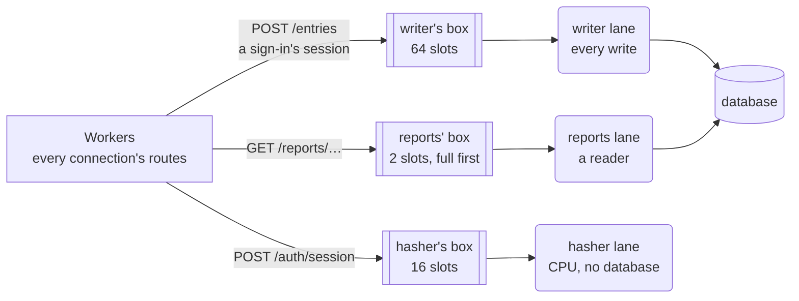

# 6. Lanes and jobs

A *worker* is the thread that takes requests and runs their routes. A server runs one
per core by default, and each serves thousands of connections, one call at a time
([State](../tutorial/08-state.md)). So a worker must not stop: not to wait for the
database, and not to compute for long. That work goes to a lane, as a job:

- A **lane** is a thread of the program, or several threads that run the same jobs,
  for one kind of slow work: writing to the database, reading for reports, hashing
  passwords. Each thread takes its jobs from its **box**, a queue with a fixed number of
  slots.
- A **job** is one use case, such as "create this entry": a variant of its lane's enum
  of jobs. A route sends it to a lane with `plod::ask`, as a small message. The worker
  serves its other connections until the reply comes back. On the lane, the job's `run`
  case function does it from start to end, in one transaction
  ([Work that waits](../tutorial/11-waiting.md)).

[Concepts and naming](concepts.md#11-the-concepts) gives their equivalents in other frameworks.

The code on this page is from [`lanes/`](lanes/), a slice of the time-tracking API with
three domains: `entries`, `reports`, and `auth`. Its lanes keep their data in memory in
place of a database.

## 6.1 A lane for each kind of slow work

Split slow work by the resource it occupies: the database's one write connection,
a read connection, or a CPU core. Give each kind a lane of its own, named for what it
does. The program has three lanes:

| Lane | What it does | Its jobs | Threads | Box |
|---|---|---|---|---|
| `writer` | Runs every write to the database, one at a time | `Writes.EntryCreate`, `Writes.AuthSession` | 1 | 64 slots |
| `reports` | Reads the database for reports, and sums what it reads | `Reports.ReportTotals` | 1 | 2 slots |
| `hasher` | Checks passwords: CPU work, with no database | `Hashes.AuthPassword` | 2 | 16 slots each |



A job then waits only behind jobs of its own kind. A slow report holds a reader, not the
writer, so entries can still be written. A password check occupies the hasher without
holding up the database. A full box refuses a job at once with 503, while the other
boxes still take theirs.

Each lane's jobs are an enum of its own in [`lanes/app.goose`](lanes/app.goose), a
variant per use case, with the route that asks for it in a comment, a route's jobs
together and in the order they run. `Use` has a *mark* for each lane: what a route
waiting on that lane keeps in its request state.

```rust
// Each lane's jobs: a use case each, and the route that asks for it, a
// route's jobs together and in the order they run.
enum Writes {
    EntryCreate { input: entries::CreateInput },   // entries::create
    AuthSession { user: i64 },                     // auth::sign_in, after the password
}
enum Reports { ReportTotals { project: i64, ms: i64 } }               // reports::project
enum Hashes { AuthPassword { email: u8[..64], password: u8[..64] } }  // auth::sign_in

// The lane a route waits on: a mark for each lane, or None.
enum Use { None, Write, Report, Hash }
```

Every route that waits, and each of its jobs, is then listed in one place, so a reader
sees which lane does what before opening a domain's files. `plod::ask` takes only its
lane's enum, so a job sent to the wrong lane doesn't compile, and each lane's `run`
cases take that lane's own state:

```rust
// What each lane's thread owns: the writer's tables, the rows the reports
// read, and the users the hasher checks.
struct Writer { entries: entries::Entry[>..]&, sessions: auth::Session[>..]& }
struct Reader { entries: const entries::Entry[:] }
struct Hasher { users: const auth::User[:] }
```

The program's database stands in for one over the
network, where each lane's thread holds its own connection. With embedded SQLite, a
short query runs in the route instead, as short CPU work does
([Long CPU work goes to a lane](#63-long-cpu-work-goes-to-a-lane)), and a lane takes only
what runs long, such as a report.

A lane runs jobs from any domain, and a domain's jobs may run on several lanes: `auth`'s
password check runs on the hasher, and its session on the writer. A job's `run` is in
its domain, beside the route that asks for it
([Structuring a route that waits](#653-structuring-a-route-that-waits)).

## 6.2 How many jobs a box holds

Size a box by how long its lane's jobs take. A route waits for its reply up to a time
limit, 5 seconds by default
([504 for a late reply](../tutorial/13-limits.md#504-for-a-late-reply)). Give the box
only enough slots for jobs the lane can finish within that limit. From
[`lanes/main.goose`](lanes/main.goose):

```rust
// A box holds the jobs its lane finishes within a route's time limit, 5
// seconds by default, in a power of two of at least 2 slots.
// A write takes a millisecond or so: 64 queued wait under a tenth of a second.
let WRITER_SLOTS: i32 = 64;
// A report can take a second or more, and it's the work to refuse first.
let REPORTS_SLOTS: i32 = 2;
// A password hash takes about 50 ms: 16 queued wait under a second.
let HASHER_SLOTS: i32 = 16;
```

A job queued beyond what its lane can finish in time starts after its client has
already received a 504, so the work is wasted. Refusing it at once instead gives the
client a 503, and a chance to try again later. To run more jobs at once, give the
lane more threads, each with its own box, rather than make one box larger
([Lanes of several threads](#66-lanes-of-several-threads)).

<details>
<summary>How <code>main.goose</code> starts the lanes</summary>

`main` opens each lane with `plod::lane_open`, naming its jobs' enum and its mark. It
starts the lane's threads, each with a box of its own, with slots of 256 bytes to fit
the largest job a route sends. It gives the workers the lanes in `App`, which a route
reads as `cx.app.writer`. At shutdown, it stops each lane with `plod::lane_stop`, which
waits for the lane's threads:

```rust
    let app = App {
        writer: plod::lane_open<Writes>(http::LaneConfig { slots: WRITER_SLOTS, .. }, Use.Write, writer),
        reports: plod::lane_open<Reports>(http::LaneConfig { slots: REPORTS_SLOTS, .. }, Use.Report, reports),
        hasher: plod::lane_open<Hashes>(http::LaneConfig { threads: 2, slots: HASHER_SLOTS, .. }, Use.Hash, hasher),
    };
    let cfg = http::Config { port: port as i32, workers: 1, mail_slots: 64, max_waiting: 1024, .. };
    http::run(cfg, app, worker);
    // A flag in each box, not a message: a full box can't refuse it. Each
    // lane_stop waits for its lane's threads.
    plod::lane_stop(app.writer);
    plod::lane_stop(app.reports);
    plod::lane_stop(app.hasher);
```

</details>

<details>
<summary>What a lane's thread runs</summary>

A lane's thread owns the lane's state, and hands each job in its box to the job's `run`
with `plod::lane`. Its `plod::Jobs<Writes>` parameter names the lane's enum, which
`plod::lane_open` checks, so a thread opened for another lane doesn't compile. The
writer:

```rust
// The writer lane, one thread: the database's one writer. It owns the entries
// and the sessions, and runs every job that writes, one at a time.
thread_fn writer(box: http::Box, jobs: plod::Jobs<Writes>) {
    var all: entries::Entry[>..] = [];
    var sessions: auth::Session[>..] = [];
    var w = Writer { entries: all, sessions: sessions };
    // Each job in the box, in order, to its run case function, until main
    // stops the lane.
    plod::lane(box, jobs) { u, a => run(u, w, a); };
}
```

</details>

## 6.3 Long CPU work goes to a lane

Short CPU work stays in the route: parsing, formatting, a query on embedded SQLite.
When the workers already use every core, a lane adds no throughput for it
([Waiting on a lane](../architecture.md#waiting-on-a-lane)). Long CPU work is different:
a route that computes for 50 ms holds up the worker's other connections for 50 ms, as a
blocking query would, because a worker is one thread for all of them. Send it to a
lane, where the operating system interleaves it with the workers: hashing a password,
summing a long period's entries for a report, rendering a file to export.

Signing in shows the whole path. Password hashing gets a lane of its own, the hasher,
because it occupies a core for tens of milliseconds. With scrypt at common settings,
it also uses 32 MiB of memory per call.

**1. The route reads the request and asks the hasher.** It checks only that the fields
are present, puts them in a job, and returns. The worker serves other connections
while the hasher works. From [`lanes/auth/routes.goose`](lanes/auth/routes.goose):

```rust
fn sign_in(cx) {
    let email, has_email = plod::form(cx, "email");
    plod::require(cx, "email", has_email);
    let password, has_password = plod::form(cx, "password");
    plod::require(cx, "password", has_password);
    // Returns at once; at the reply, the worker calls resume(u: Hashes.AuthPassword, cx).
    plod::ask(cx, cx.app.hasher, Hashes.AuthPassword { email: email, password: password });
}
```

**2. The hasher's thread runs the job.** `plod::lane` hands it to the job's `run`, which
finds the user, calls the rule, and replies with the user's id. A wrong password fails
the route from the lane: `auth::check` calls `plod::fail` with the lane's `a`, as it
does with a route's `cx`, and the route answers 401 before its `resume` runs:

```rust
// On the hasher lane: CPU work, through the rule. A wrong password fails the
// route from here, with 401.
fn ::run(u: Hashes.AuthPassword, h: Hasher&, a) {
    let user, err = auth::signed_in(h.users, u.email, u.password);
    auth::check(err, a);
    plod::reply_value(a, user);
}
```

**3. The rule does the CPU work.** `signed_in` and `hashed` are plain functions of typed
input with no `cx`, so a test calls them without a server, a thread, or a database.

**4. The reply wakes the route.** The route continues in its `resume` for the job,
which opens the session
([A route with two slow steps](#652-a-route-with-two-slow-steps)).

<details>
<summary>The rules, and the hasher's thread</summary>

From [`lanes/auth/rules.goose`](lanes/auth/rules.goose). `hashed` stands in for a real
password hash, which a program takes from a library:

```rust
// How many times hashed runs over the password: enough to take a few
// milliseconds of CPU, as a real password hash does.
let ROUNDS: i64 = 1000000;

// password hashed with salt. It stands in for scrypt or Argon2: work that
// takes CPU, not waiting.
fn hashed(password: const u8[:], salt: u64) -> u64 {
    var h: u64 = 14695981039346656037 ^ salt;
    for r in ROUNDS {
        for c in password { h = (h ^ c) * 1099511628211; }
    }
    return h;
}

// The user that email and password name, or why there's none.
fn signed_in(users: const User[:], email: const u8[:], password: const u8[:]) -> i64, Error {
    for u in users {
        if u.email == email {
            guard hashed(password, u.salt) == u.hash else { return 0, Error.BadCredentials; }
            return u.id, Error.None;
        }
    }
    return 0, Error.BadCredentials;
}
```

From [`lanes/main.goose`](lanes/main.goose):

```rust
// A thread of the hasher lane: password checks, work that takes CPU, not
// waiting, so that it holds up neither the worker's connections nor the writer.
thread_fn hasher(box: http::Box, jobs: plod::Jobs<Hashes>) {
    var h = Hasher { users: auth::USERS };
    plod::lane(box, jobs) { u, a => run(u, h, a); };
}
```

</details>

The hasher's two threads limit sign-ins to two cores. During a burst, sign-in jobs
wait in the hashers' boxes. Once both are full, more sign-ins get 503 while the workers
keep answering every other route.

Work that reads and then computes, such as a report, needs no separate lane for the
computation. One job on the reports lane reads the entries and calls the rule to sum them
([Choosing which work is refused under load](#64-choosing-which-work-is-refused-under-load)).

## 6.4 Choosing which work is refused under load

Give work that the product can do without under load, such as reports and exports,
its own lane with a small box. When too many reports arrive, that box fills and refuses
them with 503. The other lanes go on with every other route's work:

```text
GET /reports/projects/1?ms=500 000
GET /reports/projects/1 000
GET /reports/projects/1 000
GET /reports/projects/1 503 {"error":"unavailable"}
POST /entries 201 {"id":2,"project":2,"started":1767268800,"stopped":1767270600}
```

A user then can't get a report for a while, but they can still start and stop their
timer. With one box for every job, a burst of reports would fill it, and starting a
timer would get the 503.

The reports lane skips jobs whose clients have gone. Here, two clients gave up while
their jobs waited in the box. A `run` that returns without replying refuses its job
with 500 `no_reply`, which no one waits for here:

```rust
// On the reports lane: the query, then the rule that sums. A report whose
// client has gone isn't run.
fn ::run(u: Reports.ReportTotals, r: Reader&, a) {
    guard plod::still_wanted(a) else { return; }
    if u.ms > 0 { sleep_ms(u.ms); }
    plod::reply_value(a, reports::totals(r.entries, u.project));
}
```

The lane then spends its time only on reports that clients are still waiting for
([A client that has gone](../tutorial/13-limits.md#a-client-that-has-gone)).

## 6.5 Continuing a route when the reply comes

A route that asks a lane returns at once, and the worker serves other connections. When
the reply arrives, the worker calls the route again, at the `resume` case function of
the lane's mark. The reply carries its job back, so that `resume` dispatches again, to
the `resume` for the job. From [`lanes/app.goose`](lanes/app.goose):

```rust
// Each mark's resume: the reply carries its job back, which resume
// dispatches on again, to the domain's resume for that job.
fn resume(u: Use.None, cx) { plod::fail(cx, 500, "not_waiting"); }
fn resume(u: Use.Write, cx) { resume(plod::job<Writes>(cx), cx); }
fn resume(u: Use.Report, cx) { resume(plod::job<Reports>(cx), cx); }
fn resume(u: Use.Hash, cx) { resume(plod::job<Hashes>(cx), cx); }
```

A job's `resume` gets the job as the route sent it, so what it needs from the request
travels in the job, and the request state keeps only the mark. A job and its answer
longer than one message of the worker's box, 256 bytes by default, come in pieces,
which the worker collects within the reply limit `plod::ask` takes, promised from its
gather budget, before the `resume` runs
([Lanes](../reference.md#41-lanes)). To send a long answer on as it comes, reply with
`plod::reply` and answer with `plod::relay`
([A reply in pieces](../tutorial/12-two-lanes.md#a-reply-in-pieces)).

Write a `run` and a `resume` for each variant, never one that takes the whole enum. An
overload of `run(u, w: Writer&, a)` with `u` untyped, or of `resume(u: Writes, cx)`,
matches every job exactly, so it takes every call, and the variants' own cases never
run. The compiler doesn't warn. `plod::lane` answers 500 `no_reply` for a catch-all
`run` that doesn't reply, but nothing catches a catch-all `resume`
([reference](../reference.md#41-lanes)).

### 6.5.1 A route with one slow step

Most routes have one piece of slow work: they ask for it once, and answer from the
reply. Creating an entry asks the writer with `Writes.EntryCreate`. Its `run` applies
the rule at the time the job runs, and a refusal, such as 422 `entry_in_future`, fails
the route from the lane. Its `resume` reads the answer and answers. From
[`lanes/entries/routes.goose`](lanes/entries/routes.goose):

```rust
fn ::run(u: Writes.EntryCreate, w: Writer&, a) {
    let e, err = entries::new_entry(u.input, w.entries.len + 1, time() as i64);
    entries::check(err, a);
    w.entries.push(e);
    plod::reply_value(a, e);
}

// On the worker: the answer.
fn ::resume(u: Writes.EntryCreate, cx) { plod::json(cx, 201, plod::answer<entries::Entry>(cx)); }
```

`plod::answer<T>` fails the route with 502 `bad_reply` for a reply that isn't a `T`, so
a `resume` needs no check of its own.

### 6.5.2 A route with two slow steps

When a route's second piece of slow work, on another lane, needs the first one's result,
the first job's `resume` asks for it, and the route waits again
([Two lanes in turn](../tutorial/12-two-lanes.md#two-lanes-in-turn)). Signing in takes
three steps:

| Step | Does | Then |
|---|---|---|
| `sign_in` | Reads the email and password | Asks the hasher with `Hashes.AuthPassword` |
| `resume(u: Hashes.AuthPassword, cx)` | Runs once the hasher accepted the password; a wrong one has failed the route with 401 | Asks the writer with `Writes.AuthSession` |
| `resume(u: Writes.AuthSession, cx)` | Answers 201 with the session | |

A wrong password fails at the first step, and the writer never sees it. Keep a route to
one slow step where you can: each wait has its own time limit and its own 503, and a 503
at the second step comes after the first lane has done its work.

### 6.5.3 Structuring a route that waits

A route that waits takes four pieces in two files: a variant of its lane's enum in
`app.goose`, and in its domain's `routes.goose`, the route, the job's `run`, and its
`resume`, in the order they run. For a second step, the next job's `run` and `resume`
follow. Each function opens with a comment saying where it runs: on the worker or on a
lane. Each `plod::ask` names the `resume` it leads to.

`run` and `resume` are declared `fn ::run` and `fn ::resume`: the lanes' enums are the
program's, declared in `app.goose` in the global namespace
([Layout by domain](layout.md#27-the-programs-types-are-in-appgoose)), so the
dispatched calls `run(u, w, a)` and `resume(...)` find only global functions. A function
declared as `::run` is global, so Goose looks up the names in its body in the global
namespace (goose_spec §11.1), and its body names the domain's own with their namespace,
as in `auth::signed_in`.

<details>
<summary>Sign-in, from its first <code>resume</code> to its answer</summary>

From [`lanes/auth/routes.goose`](lanes/auth/routes.goose), after `sign_in` and the
hasher's `run`:

```rust
// On the worker: the route's second wait, on the writer lane: at the reply,
// resume(u: Writes.AuthSession, cx).
fn ::resume(u: Hashes.AuthPassword, cx) {
    plod::ask(cx, cx.app.writer, Writes.AuthSession { user: plod::answer<i64>(cx) });
}

// On the writer lane: one write. The writer's sessions stand in for the
// sessions table.
fn ::run(u: Writes.AuthSession, w: Writer&, a) {
    let s = auth::Session { id: w.sessions.len + 1, user: u.user };
    w.sessions.push(s);
    plod::reply_value(a, s);
}

// On the worker: the answer.
fn ::resume(u: Writes.AuthSession, cx) { plod::json(cx, 201, plod::answer<auth::Session>(cx)); }
```

</details>

A test plays a job through its `run` with `plod::play`, without a thread
([Testing](testing.md)), and calls a rule as a plain function. When a domain's
`routes.goose` grows too long, it splits by operation
([When a domain grows](layout.md#23-when-a-domain-grows)).

## 6.6 Lanes of several threads

Give a lane several threads when its jobs can run side by side, such as password checks
that each take a core: `http::LaneConfig { threads: 2, .. }`, as the hasher has. Each
thread has its own box, and `plod::ask` sends a job to the least busy one, so a route
gets 503 only when every box is full. The lane's code doesn't change: each thread runs
the same `thread_fn`.

The writer stays one thread. Its entries and sessions are in its own memory, which a
second thread wouldn't see, and it stands for the database's one write connection
([A lane for each kind of slow work](#61-a-lane-for-each-kind-of-slow-work)), as SQLite
allows one writer.

`LaneConfig`'s fields, `threads`, `slots`, and `size`, and how a lane stops at shutdown
are in goose-http's
[lanes](https://github.com/kaitk/goose-http/blob/main/docs/api.md#lanes).

## 6.7 Sizing a lane's admissions and boxes

When every worker asks the same lanes, bound the asks in flight with an admission count
per worker, and size the boxes from it. Don't size the boxes for every wait goose-http
allows. One wait per connection, `max_conns`, is 16,384 a worker by default, and boxes
that hold a reply and a job for each of them take 306 MiB at 24 workers. This is the
production setting for a server whose lanes serve all its workers, such as a cache with
a lane per worker that owns the keys sent to it. HttpArena's production-stack entry,
[`bench/httparena/plod/app.goose`](../../bench/httparena/plod/app.goose), follows it.

### 6.7.1 Pick the admission count

The admission count, *A*, is the most asks a worker has on the lanes at once, each from
its `plod::try_ask` until its outcome reaches the route. Start from Little's law: the
asks in flight across all workers average the asks per second times the time each takes
from the ask to its reply, queueing included. Pick a few times that mean, so that a
worker whose connections bring it more than its share still admits them. Then check
that the boxes it implies fit your memory budget
([What it costs](#675-what-it-costs)). The HttpArena entry admits 64 asks a worker:
1,536 at 24 workers, four to eight times the 200 to 400 its load keeps in flight.

Check *A* against the connections too. When the server is the bottleneck, every
connection that sends a request waits on the lanes at once, so a worker with more such
connections than *A* refuses the rest with 503, even while its lanes keep up. With
*A* = 64 and 256 connections from wrk on `/api/items/:id`, 10 workers answered every
request, and 3 workers, 85 connections each, refused 15% with 503 `busy`
([What it costs](#675-what-it-costs) has the setup). HttpArena's production-stack opens
256 and then 1,024 connections to its edge, which pass at most 1,024 requests at once
to 24 workers: 43 a worker on average.

A larger *A* adds no throughput: past what the lanes finish, the extra asks queue in the
lanes' boxes and time out. A smaller one refuses bursts the lanes could absorb.

### 6.7.2 Count the admissions in the route

Keep the count in a global, which each worker has its own copy of. Refuse an ask past
*A* with 503 before sending it, and count it once `plod::try_ask` sends it. Call
`plod::own_waits` before the ask, so that the route gets the wait's `TIMEOUT` and the
`CLOSED` of a client that leaves. Without it, a client that leaves during the wait never
reaches the route, and its admission is never given back. The entry's route:

```rust
fn ask_cache(cx, id: i64, owner: i64, job: CacheJob) {
    guard admitted < ADMITTED else { plod::fail(cx, 503, "busy"); }
    plod::own_waits(cx, Use.None);
    let sent = plod::try_ask(cx, caches[owner % caches.len], job, 5000, REPLY_SLOT);
    guard sent != http::TOO_LONG else { plod::fail(cx, 500, "job_too_long"); }
    guard sent == http::SENT else { plod::fail(cx, 503, "unavailable"); }
    admitted++;
}
```

Give the admission back at the route's first later call with the lane's mark, before
`plod::on_reply`. That call carries the ask's outcome: the reply, the lane's refusal, the
`TIMEOUT`, or the `CLOSED`, and only one of them comes. `plod::on_reply` answers a
refusal before the mark's `resume` runs, so the count can't wait for the `resume`:

```rust
if plod::resumed(cx) {
    match cx.state.use {
        Cache => { admitted--; },
        _ => {},
    }
    plod::on_reply(cx) { resume(cx.state.use, cx); };
}
```

The mark's `resume` tells the outcomes apart by `cx.kind`. `http::WAKE` decodes the
reply. `http::TIMEOUT` answers 504 and never asks again, since a write may have run.
`http::CLOSED` returns.

### 6.7.3 Size the boxes from it

| Setting | Size | Why |
|---|---|---|
| A worker's box, `Config.mail_slots` | *A*, plus the worker's other senders, such as a pool's hand-over per connection, to a power of two | A reply for each admitted ask, and room for replies to asks that ended while their replies were in flight |
| A worker's message, `Config.mail_size` | The largest reply: the job, its 4-byte length, and the value | Each reply takes one slot. Check it at startup with `plod::echo_head_len` and `plod::value_bytes` |
| A worker's waits, `Config.max_waiting` | *A*, plus the worker's other waits | Each admitted ask holds one wait, and its outcome frees it |
| A lane's box, `LaneConfig.slots` | Four times its share of every worker's admissions, `4 × workers × A / lanes`, to a power of two | The keys spread unevenly over the lanes from moment to moment. At its share alone, 10 lanes refused 0.2% of the requests of a load they kept up with; at twice it, 0.003%; at four times, none. Not every worker's admissions: a hot key can send them all to one lane, whose box then refuses them |
| The reply's promise, `plod::try_ask`'s `most` | One message | A reply in one message collects no pieces |

Don't retry a refused ask. A retry waits in the route as the job would in a box, and
under sustained overload it delays the same 503 while it holds a connection and a timer.
Have each lane check `plod::still_wanted` before a job's work, so that a lane that
recovers from a stall skips the jobs whose clients have gone.

### 6.7.4 What is refused, and how

| Where | What happens | The client gets |
|---|---|---|
| Past the worker's admissions | The route refuses before it asks | 503 `busy`, at once |
| The lane's box is full | `plod::try_ask` returns `http::FULL` | 503 `unavailable`, at once |
| A job longer than a lane's slot | `plod::try_ask` returns `http::TOO_LONG`, a configuration error | 500 |
| The worker's box is full when the reply comes | The lane drops the reply | 504 `timeout`, at the ask's time limit |
| No reply within the ask's time limit | The route gets `TIMEOUT` | 504 `timeout` |

`plod::reply_value` and a lane's `plod::fail` wait for room when the worker's box is
full, a millisecond at a time, until the route's wait ends. That suits most lanes. Every
lane that replies to a worker shares its box, as do the pieces of a long reply, and the
room comes back within a pass of the worker's loop. A lane that every worker asks
shouldn't wait on one worker, because the other workers' jobs queue behind it. The
entry's lanes send each reply in one message with `http::mail_send`, built as
`plod::reply_value` builds it, and drop the reply when the box is full.

### 6.7.5 What it costs

A box takes its slots times the slot size plus 24 bytes, and the timer table 48 bytes a
wait. With *A* = 64, a lane per worker, 512-byte replies, and 256-byte jobs, as the
entry has:

| Workers | Boxes, from *A* | Boxes, for `max_conns` | Timers, from *A* | Timers, for `max_conns` |
|---:|---:|---:|---:|---:|
| 4 | 0.54 MiB | 51 MiB | 12 KiB | 3 MiB |
| 24 | 3.21 MiB | 306 MiB | 72 KiB | 18 MiB |
| 64 | 8.56 MiB | 816 MiB | 192 KiB | 48 MiB |

Each worker's box also keeps a live-key table of 8 bytes a connection, 128 KiB at the
default `max_conns`, however the boxes are sized.

Measured on the entry's server alone, under Docker Desktop on an M1 Pro (2026-10-23):
its own Postgres, then wrk with 4 threads and 256 connections, 15 seconds on
`/api/items/:id` over 10,000 ids and 10 seconds on `/api/me`, one run each. The peak
resident memory, `VmHWM`:

| Workers (CPUs) | Boxes from *A* | Boxes for `max_conns` |
|---:|---:|---:|
| 3 | 46 MiB | 85 MiB |
| 10 | 77 MiB | 209 MiB |

With 10 workers both answered every request, at 365,000 and 383,000 requests a second
on `/api/items/:id`: 5% apart, from one run each. With 3 workers, the boxes from *A*
refused 15% of `/api/items/:id` with 503 `busy` and still answered 6% more of it with
200, and refused 7% of `/api/me`. The boxes for `max_conns` refused none
([Pick the admission count](#671-pick-the-admission-count)).

---

[Best practices](README.md) · Previous: [Middleware and stacks](middleware.md) · Next:
[State](state.md)
