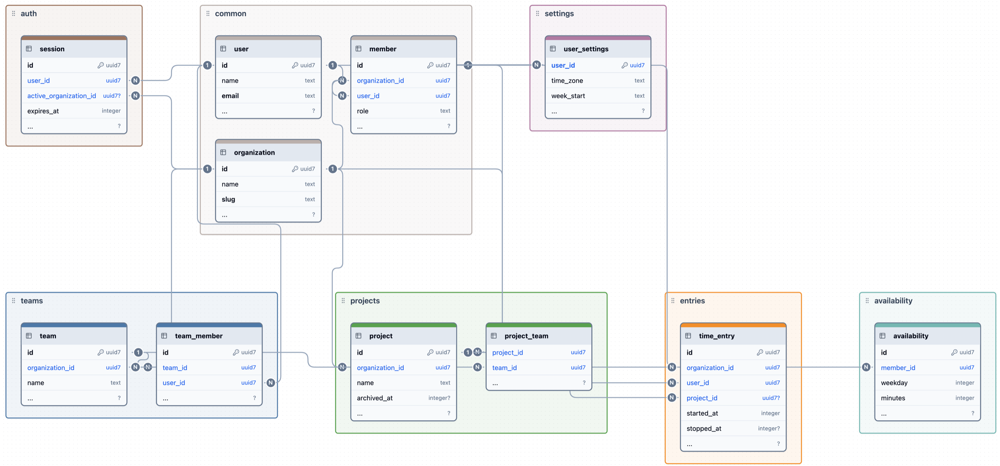

# 2. Layout by domain

An application's code is grouped by domain: the part of the product it serves, such as
projects, teams, or time entries. Each domain's folder holds that domain's structs,
errors, rules, routes, jobs, and queries. The kind of code, such as routes or rules,
names the file inside the folder, never the folder.

The examples in this guide come from a time-tracking API with eight domains and three
audiences, laid out like this:

```text
app/
  main.goose            the lanes, the workers, and rest::serve
  app.goose             App, St, Use, and each lane's jobs: what the tests import
  dispatch.goose        each audience's scope and stack, then each domain's routes
  stacks.goose          public_routes, user_routes, member_routes
  middleware.goose      authenticate, resolve_organization
  common/
    errors.goose        the errors several domains answer
    calendar/           time zones, days, and weeks
    members/            Member, and what a member may read
    users/              User
  projects/
    structs.goose       Project, CreateInput, UpdateInput, and the domain's enums
    errors.goose        Error, and the status and code each answers
    rules.goose         new_project, archived: typed input in, no cx
    routes.goose        routes(cx, member), then each route's flow in the order it
                        runs: the route, its job's run, its resume
    queries.goose       find_project, insert_project: one statement each
  entries/              (structs, errors, rules, routes, queries)
  timer/                (structs, errors, rules, routes)
  teams/                (structs, errors, rules, routes, queries)
  reports/              (structs, rules, queries, routes.goose and routes/)
  settings/             (structs, routes, queries)
  availability/         (structs, errors, rules, routes, queries)
  auth/                 (structs, errors, rules, routes, queries)
  test/                 a folder per domain, a folder per scenario, and expected/
```

In the data model below, each domain's tables share a box, with a few columns from
each table. `timer` and `reports` own no tables: they use the tables of `entries`.



The three audiences are the public, a signed-in user, and a member of an organization.
Each has a stack in `stacks.goose`. Here is what each domain is for:

- **`auth`**: signing in and out, and the session it opens. Public routes:
  `POST /auth/session` signs in, `DELETE /auth/session` signs out. Signing in checks the
  password on a lane of its own, the hasher ([Lanes and jobs](lanes.md)).
- **`settings`**: a user's own preferences, such as time zone and the first day of the
  week, the same in every organization. User routes: `GET` and `PUT /settings`.
- **`projects`**: what an organization tracks time on, and the teams on each. Member
  routes under `/organization/projects`: list, create, update, archive.
- **`teams`**: groups of members, and who is in each. Member routes under
  `/organization/teams`: list, create, add and remove a member.
- **`entries`**: the time recorded, each entry a member's span on a project. Member
  routes under `/organization/entries`: list a week, create, edit, delete.
- **`timer`**: the running entry, one per member at most. Member routes under
  `/organization/timer`: `GET` it, `POST` to start, `DELETE` to stop. It owns no data
  of its own: it starts and stops entries.
- **`reports`**: totals of entries by project, team, or member over a period, and the
  entries behind them, for export. Member routes, read only:
  `GET /organization/reports/...`. It owns no data either. Its rules sum the entries,
  and its jobs run on a lane of their own, so that under load they are refused before
  other work ([Lanes and jobs](lanes.md#64-choosing-which-work-is-refused-under-load)).
  An export's entries are a long answer, sent in pieces
  ([A reply in pieces](../tutorial/12-two-lanes.md#a-reply-in-pieces)). Its five
  operations each have a file in `reports/routes/`
  ([When a domain grows](#23-when-a-domain-grows)).
- **`availability`**: the hours each member expects to work on each weekday, which
  reports compare with the time recorded. Member routes under
  `/organization/availability`: `GET` and `PUT`.
- **`common/`**: shared code, with no routes. `users` holds `User`, and `members` holds
  `Member`, a user in an organization. The stacks look these up and pass them to every
  user or member route. It also holds the errors several domains answer, and
  `calendar`: time zones and the days and weeks that `entries`, `timer`, `reports`, and
  `availability` split time into.

[`layout/`](layout/) is a smaller program laid out the same way, with three domains:
`projects`, `teams`, and `settings`.

## 2.1 A folder per domain

Put all of a domain's code in one folder named for the domain, such as `projects/`.

A change to a feature then touches one folder, a reviewer sees the domain from the
paths alone, and the folder shows how big the domain is. Laid out by kind
(`routes/`, `rules/`, `queries/`), one feature spreads across every folder.

## 2.2 The same files in every domain

Each kind of code has one file name, the same in every domain and in `common/`:

| File | Holds | Example |
|---|---|---|
| `structs.goose` | The domain's structs and enums, and their `format` overloads | `Project`, `CreateInput` |
| `errors.goose` | The domain's `Error` enum, and the status and code of each variant | `Error.NotFound` |
| `rules.goose` | Functions of typed input that return a result or an `Error`, with no `cx` | `new_project` |
| `routes.goose` | `routes`, the domain's entry, then each route's flow in the order it runs: the route, the jobs it asks lanes for, and its `resume` case functions | `create`, `create_project` |
| `queries.goose` | The domain's data access: a function per database statement, which jobs call | `find_project` |

A domain has the files it needs and no others: `settings/` in the program has no rules
or errors, and a domain with no tables of its own, such as `timer`, has no queries.

Someone who knows one domain finds the same kinds of code in every other, and a
file's name tells a reviewer what kind of change to expect.

A route and its `resume` functions, a job, a query, and a rule are the controller, the
transactional service method, the repository, and the domain logic of a Spring
application ([Concepts and naming](concepts.md#11-the-concepts)).

A job only orchestrates: it opens the transaction, calls queries to read and write,
calls rules to decide, and commits. When a job grows, what grows is a decision that
belongs in a rule, or a statement that belongs in a query. Rules then hold the domain's
logic, and a test calls them as plain functions, with no server, thread, or database.

## 2.3 When a domain grows

Split a domain by operation once its `routes.goose` holds too many flows to follow in
one file. Keep `routes` and the paths in `routes.goose`. Move each operation's flow,
including its route, jobs, and `resume` functions, to its own file in a `routes/` folder
beside it. The domain's structs, errors, rules, and queries stay shared:

```text
reports/
  structs.goose       Report, Breakdown, the inputs, the jobs' and replies' structs
  errors.goose        Error, and check
  rules.goose         totals, split_days: the sums, with no I/O
  queries.goose       find_settings, list_entries: one statement each
  routes.goose        routes(cx, member): the paths, each calling its operation
  routes/
    totals.goose      GET /totals: the route, its job on the reports lane, its resume
    breakdown.goose   GET /breakdown: the route, its job, its resume
    export.goose      GET /export: the route, its job, its reply in pieces
```

The files in `routes/` also declare the domain's namespace, `namespace reports;`.
Moving a function between files therefore changes none of its callers. A domain can
start in one file and split as it grows, where a Java application splits into classes
from the start.

## 2.4 A domain is a namespace

Each file of a domain declares the domain's namespace, `namespace projects;`. A call
from outside the domain names it once, `projects::routes(cx, member)`, and the names
inside leave it out ([A name doesn't repeat its domain](concepts.md#12-a-name-doesnt-repeat-its-domain)).
A folder in `common/` is a namespace of the same name, such as `members`, and the
files directly in `common/` are in `common`.

## 2.5 Shared code moves to `common/`

Code starts in the domain that needs it. Move it to `common/` when a second domain needs
it, and not before. `common/` is laid out as a domain is, by the entity it serves:
`common/members/structs.goose` holds `Member`, which every member route is given.

Moving code early means guessing what other domains will need. Once a second domain
uses it, two callers show what the shared code needs to do. Laid out by entity,
`common/` reads the same way as a domain.

## 2.6 All routing in one file

`dispatch.goose` holds the routes block: each audience's scope, behind its stack, then
each domain's scope and its `routes`. From [`layout/dispatch.goose`](layout/dispatch.goose):

```rust
fn handle(cx) {
    // Middleware every answer gets, the 404s included, goes outside the routes.
    rest::timed(cx) {
        rest::routes(cx) { cx =>
            // A scope per audience, each behind its stack (stacks.goose).
            public_routes(cx) { rest::get(cx, "/health") { rest::text(cx, 200, "ok"); }; };
            rest::scope(cx, "/settings") {
                // Authenticates, or answers 401; the block gets the user.
                user_routes(cx) { user => settings::routes(cx, user); };
            };
            rest::scope(cx, "/organization") {
                // The user, then their membership of the organization the
                // request names; the block gets the member. A stranger gets
                // 401 for any path here, not 404.
                member_routes(cx) { member =>
                    rest::scope(cx, "/projects") { projects::routes(cx, member); };
                    rest::scope(cx, "/teams") { teams::routes(cx, member); };
                };
            };
        };
    };
}
```

A domain's `routes` matches the rest of the path, after its scope. From
[`layout/projects/routes.goose`](layout/projects/routes.goose):

```rust
fn routes(cx, member: members::Member) {
    rest::get(cx, "") { list(cx, member); };
    rest::post(cx, "") { create(cx, member); };
}
```

Every route's path and the stack that guards it are then in one file, so a reviewer can
see that no route skips authentication. A domain doesn't depend on its prefix, so
moving it to another path changes one line.

## 2.7 The program's types are in `app.goose`

Declare the program's types in `app.goose`, the application's entry: `App`, the worker
state; `St`, the request state; `Use`, what a route waits on, a mark for each lane; and
each lane's enum of jobs and the state its thread owns. `app.goose` imports
`dispatch.goose`, which imports the domains.
`main.goose` keeps only what a test must not run: the lanes' threads, the workers, and
`main`.

A test has a `main` of its own, so it can't import `main.goose`; it reaches the
application through `app.goose` instead ([Testing](testing.md)).

Each type is one for the whole program: every domain's routes get the same `cx`, so no
domain owns them. A domain still owns its jobs, the lanes' variants named for it, and
their `run` and `resume` functions are in its `routes.goose`
([Structuring a route that waits](lanes.md#653-structuring-a-route-that-waits)).

## 2.8 With an OpenAPI schema

The generator writes one file for the whole API, `api_gen.goose`, beside `main.goose`,
and its router calls every handler in one namespace, `app` by default
([Run it](../generator.md#1-run-it)). The generator can't yet write each domain's part
into its folder, by the operations' OpenAPI `tags`, so for now keep the handlers in
one file. Each handler calls its domain's rules or asks for
its job; the rest of the code stays in the domain.

---

[Best practices](README.md) · Previous: [Concepts and naming](concepts.md) · Next:
[Routes and rules](routes-and-rules.md)
