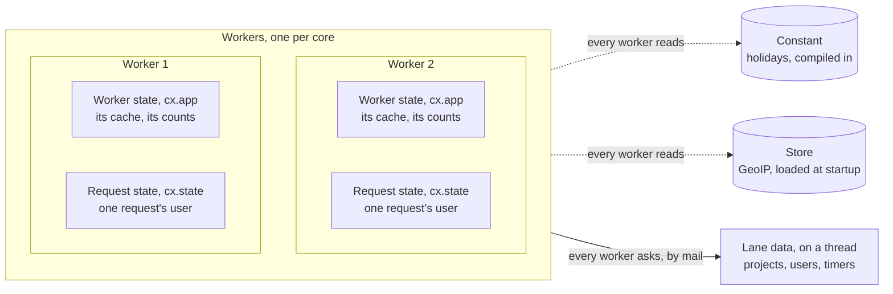

# State

Workers share nothing, so where data lives decides who can see it and what reaching it
costs. Data lives in one of five places, each with its own name.
[State](../tutorial/08-state.md) shows how to reach each one, and this page which to
use.

The code on this page is from [`state/`](state/).

## Choose the place by what the data is

The five places, in a server with two workers:



| Place | The data | How |
|---|---|---|
| **Constant** | Known at build time: holidays, translations, lookup tables | A global with a literal value, compiled into the program |
| **Store** | Loaded at startup, and too large to copy into every worker: a GeoIP database, a catalog | goose-http's `http.store` ([state that workers share](https://github.com/kaitk/goose-http/blob/main/docs/patterns.md#state-that-workers-share)) |
| **Lane data** | Changing, and every worker must see the change: the projects, the users, a member's running timer | A lane, a thread that owns it, which routes ask ([Lanes and jobs](lanes.md)) |
| **Worker state** | A worker's own, where workers may differ: a cache, the counts of a limit that sheds load | `App`, reached as `cx.app` |
| **Request state** | One request's own: the signed-in user, looked up once | `St`, reached as `cx.state`, with `rest::once` |

Each row is the cheapest place that still gives every request the right answer. Data
that must look the same to every worker isn't worker state, and data that one worker can
keep doesn't cost a message to another thread.

## Data known at build time is a constant

Write data that ships with a release as a constant, a global with a literal value. From
[`state/app.goose`](state/app.goose):

```rust
// Known at build time: compiled into the program, for every worker to read.
let HOLIDAYS = [
    Holiday { date: "2026-02-24", name: "Independence Day" },
    Holiday { date: "2026-06-24", name: "Midsummer Day" },
];
```

The program compiles it in rather than loading it at startup, so a change to it is a
code change, reviewed and released with the code. Don't load data into a global in
`main` before the workers start: each worker gets a copy of it
([State](../tutorial/08-state.md#worker-state)).

## What worker state holds

Keep in `cx.app` only data whose value may differ from one worker to the next without a
wrong answer: a cache, a count, a connection of the worker's own. Its type is `App`,
declared in `app.goose` ([Layout by domain](layout.md#the-programs-types-are-in-appgoose)),
and each worker builds its own in `main.goose`:

```rust
// The worker state: it lasts as long as the worker, and no other
// worker sees it.
struct App { lookups: i64 }
```

```rust
thread_fn worker(cfg: http::Config) {
    // Each worker's own App, which its routes reach as cx.app.
    var app = App { lookups: 0 };
    let e = rest::serve(cfg, app) { cx => handle(cx) };
```

<details>
<summary>The routes that read the global and count in <code>cx.app</code></summary>

From [`state/app.goose`](state/app.goose):

```rust
fn handle(cx) {
    rest::routes(cx) { cx =>
        if rest::on(cx, "GET", "/health") {
            rest::text(cx, 200, "ok");
        } else if rest::on(cx, "GET", "/holidays") {
            rest::route(cx) {
                // This worker's own count: each worker keeps one.
                cx.app.lookups++;
                // The global, compiled into the program, which every worker reads.
                rest::json(cx, 200, HOLIDAYS);
            };
        } else if rest::on(cx, "GET", "/lookups") {
            rest::route(cx) { rest::text(cx, 200, str(cx.app.lookups)); };
        } else {
            rest::otherwise(cx);
        }
    };
}
```

</details>

A client's next request may reach another worker. Data that must be the same for the client
on that worker, such as a project just created, is lane data. The programs in this
section and the tutorial keep projects in worker state only because they run one worker.

## Rate limits: worker state or lane data

Keep the count for a limit that protects an account, such as failed sign-ins per user,
in lane data, so requests on every worker add to the same count. Use worker
state only for limits that protect the worker itself from load.

A client's connections may reach any worker, so a count per worker multiplies the limit
by the number of workers: with eight workers, eight times as many guesses at a password.
A limit on the worker's own load is right in worker state, because each worker's load is
its own.

---

[Best practices](README.md) · Previous: [Lanes and jobs](lanes.md) · Next:
[Testing](testing.md)
