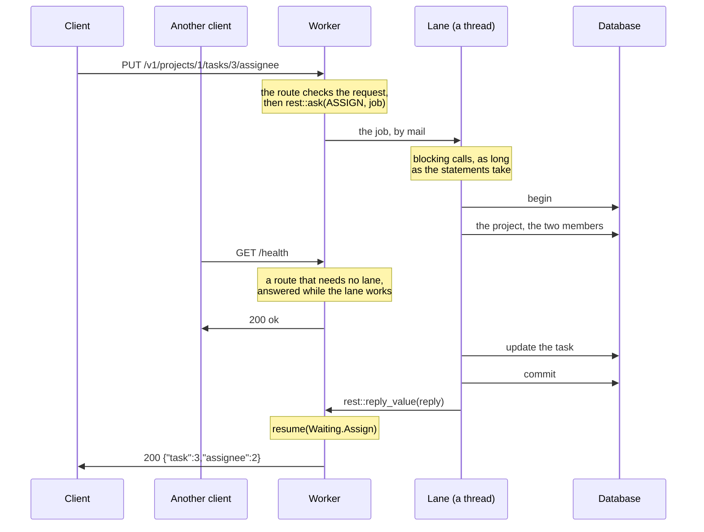

# 11. Work that waits

The projects now move into a database. Its driver blocks: a query sends a statement,
and the call returns when the rows come back. A worker serves thousands of connections
on one thread, so a route that waits for the database makes all of them wait. This page
runs a query in the route first, to show the cost, then moves the queries to a lane that
owns the connection, so the worker serves its other connections meanwhile.

The route then returns before it answers, and the worker calls the handler again when
the reply comes. Every later call works this way, through the same case functions: the
pieces of a body on [page 14](14-bodies-in-pieces.md), and of a response on
[page 15](15-long-responses.md).

The database here is the tutorial's own [`db`](db/db.goose): in-memory rows read and
written by the statements used in these pages. Each statement sleeps for 20 ms to
stand in for a query over the network. Its calls look like a Rust driver's, such as
sqlx's: a connection, a statement with bound parameters, and rows read into structs.
A real driver can replace it without changing the pages.

## Blocking the worker

A query that takes microseconds, such as one on an embedded SQLite database, can run in
the route. From [`11-waiting`](11-waiting/app.goose):

```rust
    if rest::on(cx, "GET", "/in-place/projects/:id") {
        // Blocks the worker, and every connection it holds, for the query.
        let id = rest::param_int(cx, "id");
        let p, found = db::fetch_one<db::Project>(cx.app.conn, "SELECT * FROM projects WHERE id = $1", [id]);
        guard found else { rest::fail(cx, 404, "project_not_found"); }
        rest::json(cx, 200, project_of(p));
```

While this query waits, every other connection on the worker waits too: 20 ms here for
each connection. Each worker also has its own copy of the program's state, so it needs
its own database connection and can't see another worker's transaction.

## Lanes and jobs

Work that waits goes to a *lane*: a thread of the program, or several threads that run
the same jobs, for one kind of slow work, here the database's, with the connections it
owns. A route sends the lane a *job*, one use case as a message, and returns.
[Concepts and naming](../best-practices/concepts.md) has what other frameworks
call each:



The worker never blocks on the database. The lane's thread does nothing else, and its
calls block for as long as the statements take: a slow query holds up only the jobs
queued behind it in the lane's box, not the worker's connections. The limits apply on
the route's side: how long the route waits, and how many jobs the box holds
([Limits](13-limits.md)). goose-http's
[slow work](https://github.com/kaitk/goose-http/blob/main/docs/patterns.md#slow-work)
shows the same exchange at the event loop's level, and
[mail between threads](https://github.com/kaitk/goose-http/blob/main/docs/patterns.md#mail-between-threads)
how a box works.

The job is a complete use case, which the lane runs from start to end with plain
blocking calls, as the body of an Axum or Express handler would. Assigning a task checks
that the project exists and that both the requesting user and the assignee are members,
then updates the task: four statements in one transaction. From
[`database.goose`](11-waiting/database.goose):

```rust
// Assigns a task, for a user who is a member of its project, to another
// member: four statements in one transaction.
fn assign(c: db::Conn&, j: AssignJob) -> AssignReply {
    db::begin(c);

    // The project exists.
    let p, found = db::fetch_one<db::Project>(c, "SELECT * FROM projects WHERE id = $1", [j.project]);
    guard found else { db::rollback(c); return AssignReply { status: 404, code: "project_not_found" }; }

    // The user asking is one of its members, and so is the assignee.
    let m, member = db::fetch_one<db::Member>(c, "SELECT * FROM members WHERE project = $1 AND user = $2", [j.project, j.user]);
    guard member else { db::rollback(c); return AssignReply { status: 403, code: "not_a_member" }; }
    let a, assignable = db::fetch_one<db::Member>(c, "SELECT * FROM members WHERE project = $1 AND user = $2", [j.project, j.assignee]);
    guard assignable else { db::rollback(c); return AssignReply { status: 409, code: "assignee_not_a_member" }; }

    // The task is in the project: the update changes one row, or none.
    let n = db::execute(c, "UPDATE tasks SET assignee = $1 WHERE id = $2 AND project = $3", [j.assignee, j.task, j.project]);
    guard n == 1 else { db::rollback(c); return AssignReply { status: 404, code: "task_not_found" }; }

    db::commit(c);
    return AssignReply { .. };
}
```

The job and its reply are flat structs, which go between threads as bytes, one message
each. A reply that carries an error's status and code lets the route answer in the
common error shape:

```rust
struct AssignJob { project: i64, task: i64, user: i64, assignee: i64 }
struct AssignReply { status: i32 = 200, code: u8[..32] = "" }
```

The lane's thread takes each job from its box with `rest::asked<J>`, which also keeps
where the reply goes, and replies with `rest::reply_value`:

```rust
            } else if tag == ASSIGN {
                let a, ok = rest::asked<AssignJob>(bytes);
                if ok { rest::reply_value(a, assign(c, a.job)); }
```

<details>
<summary>The lane's thread, and how <code>main</code> starts it</summary>

The thread sleeps until mail comes, takes each job in its box by its tag, and stops at
`STOP`. From [`database.goose`](11-waiting/database.goose):

```rust
thread_fn run(box: http::Box, delay_ms: i64) {
    var c = db::open(delay_ms);
    var running = true;
    while running {
        http::mail_wait(box, 1000);
        http::mail_take(box) { key, tag, bytes =>
            if tag == PROJECT {
                let a, ok = rest::asked<ProjectJob>(bytes);
                if ok { rest::reply_value(a, project(c, a.job)); }
            } else if tag == ASSIGN {
                let a, ok = rest::asked<AssignJob>(bytes);
                if ok { rest::reply_value(a, assign(c, a.job)); }
            } else if tag == STOP {
                running = false;
            }
        };
    }
    http::mail_close(box);
}
```

`main` opens the lane's box, starts its thread, and gives the worker the box's address.
Waiting is off until `Config.mail_slots` and `max_waiting` are set
([goose-http's answers that wait](https://github.com/kaitk/goose-http/blob/main/docs/api.md#answers-that-wait)).
From [`main.goose`](11-waiting/main.goose):

```rust
    let box, e = http::mail_open(64, 256);
    http::exit_on_error(e);
    let to = http::address(box, 0);
    let st = thread_spawn(database::run, box, DELAY_MS);
    let cfg = http::Config { port: port as i32, workers: 1, mail_slots: 64, max_waiting: 1024, .. };
    thread_wait(thread_spawn(worker, cfg, to));
    http::mail_send(to, database::STOP, "");
    thread_wait(st);
```

</details>

## Asking a lane, and resuming

The route reads and checks the request, then calls `rest::ask` once, passing the
lane's address, the job tag, the job, and the state it needs when the reply comes. From
[`app.goose`](11-waiting/app.goose), which holds the routes apart from `main` so that
a test can import them:

```rust
    } else if rest::on(cx, "PUT", "/projects/:id/tasks/:task/assignee") {
        let user, has_user = rest::header(cx, "X-User");
        rest::require(cx, "X-User", has_user);
        let assignee, has_assignee = rest::query_int(cx, "user");
        rest::require(cx, "user", has_assignee);
        let job = database::AssignJob {
            project: rest::param_int(cx, "id"), task: rest::param_int(cx, "task"),
            user: rest::int_of(cx, user, "X-User"), assignee: assignee,
        };
        // Returns at once; the reply comes to resume(Waiting.Assign).
        rest::ask(cx, cx.app.db, database::ASSIGN, job, Waiting.Assign { task: job.task, assignee: assignee });
```

Goose has no `async` and can't store a closure to call later. Instead, the state the
route needs when it resumes goes in a variant of the program's `Waiting` enum.
`rest::ask` stores this in the request state:

```rust
// What each route that waits needs when its reply comes.
enum Waiting {
    None,
    Project,
    Assign { task: i64, assignee: i64 },
}

struct St { waiting: Waiting = Waiting.None }
```

When the reply arrives, the handler runs again. `rest::resumed` is true for every call
after the request's first, so the handler dispatches to the `resume` case function for
the current variant. The compiler checks that every variant has one:

```rust
    let e = rest::serve(cfg, app, St { .. }) { cx =>
        if rest::resumed(cx) {
            rest::route(cx) { resume(cx.state.waiting, cx); };
        } else {
            handle(cx);
        }
    };
```

```rust
fn resume(w: Waiting.Assign, cx) {
    // The lane's reply, read as the struct it sent; not one is a bug: 502.
    let r, ok = rest::read_reply<database::AssignReply>(cx);
    guard ok else { rest::fail(cx, 502, "bad_reply"); }
    guard r.status < 400 else { rest::fail(cx, r.status, r.code); }
    rest::json(cx, 200, Assigned { task: w.task, assignee: w.assignee });
}
```

```text
PUT /v1/projects/1/tasks/3/assignee?user=2 200 {"task":3,"assignee":2}
PUT /v1/projects/9/tasks/3/assignee?user=2 404 {"error":"project_not_found"}
PUT /v1/projects/1/tasks/3/assignee?user=2 403 {"error":"not_a_member"}
PUT /v1/projects/1/tasks/3/assignee?user=3 409 {"error":"assignee_not_a_member"}
PUT /v1/projects/1/tasks/6/assignee?user=2 404 {"error":"task_not_found"}
```

## One job per route

A route could instead ask once per query and resume after each, forming a state machine
with a `Waiting` variant and a case function per query. One job per route is the default,
for three reasons:

- A use case reads as one function, next to its data, and its queries share one
  transaction. A route that waits once per query can't hold a transaction across its
  waits without tying a connection to a request.
- Each route waits once: one `Waiting` variant, one time limit, and one place where a
  full box refuses work ([Limits](13-limits.md)).
- A use case is tested as a plain call on a job, without a request or threads, as
  [`test.goose`](11-waiting/test.goose) does ([Testing the application](16-testing.md)
  covers the routes too):

```rust
    var c = db::open(0);
    expect(database::assign(c, database::AssignJob { project: 1, task: 3, user: 1, assignee: 2 }), 200, "");
    assert(assignee(c, 3) == 2);
```

The cost is that jobs and replies cross between threads as flat values, and a route's
HTTP side and its use case are separate functions. Checks that need the database before
the route's work, such as looking up a session by its cookie, go in the job, so that the
route still waits once. A route that needs two lanes in turn waits twice:
[the next page](12-two-lanes.md).

*Note: an application with more slow work than one database gives each kind a lane of
its own, so that a job waits only behind jobs of its kind, as the best practices
recommend ([Lanes and jobs](../best-practices/lanes.md#a-lane-for-each-kind-of-slow-work)).*

---

[Index](README.md) · Previous: [10. Large bodies](10-large-bodies.md) · Next:
[12. Two lanes, or a reply in pieces](12-two-lanes.md)
