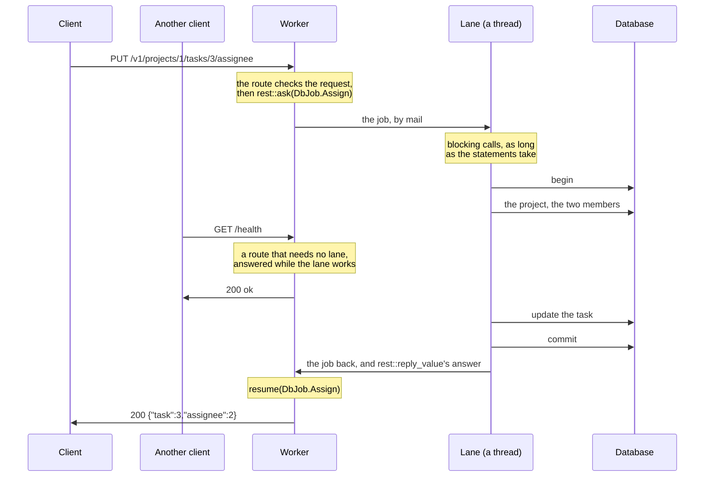

# 11. Work that waits

The projects now move into a database. Its driver blocks: a query sends a statement,
and the call returns when the rows come back. A worker serves thousands of connections
on one thread, so a route that waits for the database makes all of them wait. This page
runs a query in the route first, to show the cost, then moves the queries to a lane that
owns the connection, so the worker serves its other connections meanwhile.

The route then returns before it answers, and the worker calls the handler again when
the reply comes. Every later call works this way, through the same case functions: the
pieces of a body on [page 14](14-bodies-in-pieces.md), and of a response on
[page 15](15-long-responses.md).

The database here is the tutorial's own [`db`](db/db.goose): in-memory rows read and
written by the statements used in these pages. Each statement sleeps for 20 ms to
stand in for a query over the network. Its calls look like a Rust driver's, such as
sqlx's: a connection, a statement with bound parameters, and rows read into structs.
A real driver can replace it without changing the pages.

## Blocking the worker

A query that takes microseconds, such as one on an embedded SQLite database, can run in
the route. From [`11-waiting`](11-waiting/app.goose):

```rust
    if rest::on(cx, "GET", "/in-place/projects/:id") {
        // Blocks the worker, and every connection it holds, for the query.
        let id = rest::param_int(cx, "id");
        let p, found = db::fetch_one<db::Project>(cx.app.conn, "SELECT * FROM projects WHERE id = $1", [id]);
        guard found else { rest::fail(cx, 404, "project_not_found"); }
        rest::json(cx, 200, project_of(p));
```

While this query waits, every other connection on the worker waits too: 20 ms here for
each connection. Each worker also has its own copy of the program's state, so it needs
its own database connection and can't see another worker's transaction.

## Lanes and jobs

Work that waits goes to a *lane*: a thread of the program, or several threads that run
the same jobs, for one kind of slow work, here the database's, with the connections it
owns. A route sends the lane a *job*, one use case as a message, and returns.
[Concepts and naming](../best-practices/concepts.md) has what other frameworks
call each:



The worker never blocks on the database. The lane's thread does nothing else, and its
calls block for as long as the statements take: a slow query holds up only the jobs
queued behind it in the lane's box, not the worker's connections. The limits apply on
the route's side: how long the route waits, and how many jobs the box holds
([Limits](13-limits.md)). goose-http's
[slow work](https://github.com/kaitk/goose-http/blob/main/docs/patterns.md#slow-work)
shows the same exchange at the event loop's level, and
[mail between threads](https://github.com/kaitk/goose-http/blob/main/docs/patterns.md#mail-between-threads)
how a box works.

A lane's jobs are the variants of an enum of its own, a variant per use case, with
what the use case needs. The database lane has two: reading a project, and assigning a
task. From [`app.goose`](11-waiting/app.goose):

```rust
// The database lane's jobs: a use case each, with what it needs.
enum DbJob {
    Project { id: i64 },
    Assign { project: i64, task: i64, user: i64, assignee: i64 },
}
```

The job is a complete use case, which the lane runs from start to end with plain
blocking calls, as the body of an Axum or Express handler would. The program writes
it as a `run` case function for the job's variant, which the lane's thread calls.
Assigning a task checks that the project exists and that both the requesting user and
the assignee are members, then updates the task: four statements in one transaction.
From [`database.goose`](11-waiting/database.goose):

```rust
// Assigns a task, for a user who is a member of its project, to another
// member: four statements in one transaction.
fn run(u: DbJob.Assign, c: db::Conn&, a) {
    db::begin(c);

    // The project exists.
    let p, found = db::fetch_one<db::Project>(c, "SELECT * FROM projects WHERE id = $1", [u.project]);
    guard found else { db::rollback(c); rest::fail(a, 404, "project_not_found"); }

    // The user asking is one of its members, and so is the assignee.
    let m, member = db::fetch_one<db::Member>(c, "SELECT * FROM members WHERE project = $1 AND user = $2", [u.project, u.user]);
    guard member else { db::rollback(c); rest::fail(a, 403, "not_a_member"); }
    let n, assignable = db::fetch_one<db::Member>(c, "SELECT * FROM members WHERE project = $1 AND user = $2", [u.project, u.assignee]);
    guard assignable else { db::rollback(c); rest::fail(a, 409, "assignee_not_a_member"); }

    // The task is in the project: the update changes one row, or none.
    let rows = db::execute(c, "UPDATE tasks SET assignee = $1 WHERE id = $2 AND project = $3", [u.assignee, u.task, u.project]);
    guard rows == 1 else { db::rollback(c); rest::fail(a, 404, "task_not_found"); }

    db::commit(c);
    rest::reply_value(a, Assigned { task: u.task, assignee: u.assignee });
}
```

`a` is where the reply goes. `rest::reply_value(a, v)` replies `v`, a flat value, which
goes between threads as bytes. `rest::fail(a, status, code)` fails the
route that asked, with that status and code, as it does in a route: the error crosses
the lane, as a `throw` crosses an `await`. A `run` that does neither gets the route
500 `no_reply`.

<details>
<summary>The lane's thread, and how <code>main</code> starts it</summary>

The thread hands each job in its box to its `run` case function with `rest::lane`,
which sleeps until mail comes, and returns once `main` stops the lane and every job
queued before is done. From [`database.goose`](11-waiting/database.goose):

```rust
thread_fn database(box: http::Box, delay_ms: i64) {
    var c = db::open(delay_ms);
    rest::lane<DbJob>(box) { u, a => run(u, c, a); };
}
```

`run(u, c, a)` dispatches on the job's variant, as a `match` would, and the compiler
checks that every variant of `DbJob` has its `run`. `main` opens the lane with
`rest::lane_open`, naming its jobs' enum and its *mark*, `Use.Db`, below. It starts the
thread with a box of 64 slots of 256 bytes and passes it `DELAY_MS`. It gives the
worker the lane, and stops it with `rest::lane_stop` once the worker returns, which
waits for the thread. Waiting is off until `Config.mail_slots` and `max_waiting` are
set ([goose-http's lanes](https://github.com/kaitk/goose-http/blob/main/docs/api.md#lanes)).
From [`main.goose`](11-waiting/main.goose):

```rust
    let lane = rest::lane_open<DbJob>(http::LaneConfig { .. }, Use.Db, DELAY_MS, database);
    let cfg = http::Config { port: port as i32, workers: 1, mail_slots: 64, max_waiting: 1024, .. };
    http::run(cfg, lane, worker);
    rest::lane_stop(lane);
```

</details>

## Asking a lane, and resuming

The route reads and checks the request, then calls `rest::ask` once, passing the lane
and the job. From [`app.goose`](11-waiting/app.goose), which holds the routes apart
from `main` so that a test can import them:

```rust
    } else if rest::on(cx, "PUT", "/projects/:id/tasks/:task/assignee") {
        let user, has_user = rest::header(cx, "X-User");
        rest::require(cx, "X-User", has_user);
        let assignee, has_assignee = rest::query_int(cx, "user");
        rest::require(cx, "user", has_assignee);
        // Returns at once; the reply comes to resume(u: DbJob.Assign, cx).
        rest::ask(cx, cx.app.db, DbJob.Assign {
            project: rest::param_int(cx, "id"), task: rest::param_int(cx, "task"),
            user: rest::int_of(cx, user, "X-User"), assignee: assignee,
        });
```

`cx.app.db` is a `rest::Lane<DbJob, Use>`, so `rest::ask` takes only a `DbJob`: a job
sent to the wrong lane doesn't compile.

Goose has no `async` and can't store a closure to call later. Instead, `rest::ask`
keeps the lane's mark in the request state: a variant of the program's `Use` enum,
which says what the route waits on, with `None` first:

```rust
// What a route waits on: here, the database lane.
enum Use { None, Db }

struct St { use: Use = Use.None }
```

When the reply arrives, the handler runs again. `rest::resumed` is true for every call
after the request's first, so the handler calls `rest::on_reply`, which dispatches to
the `resume` case function for the variant in `cx.state.use`. The compiler checks that
every variant has one:

```rust
    let e = rest::serve(cfg, app, St { .. }) { cx =>
        if rest::resumed(cx) {
            rest::on_reply(cx) { resume(cx.state.use, cx); };
        } else {
            handle(cx);
        }
    };
```

The lane's reply carries its job back in front of the answer. The mark's `resume`
reads it with `rest::job` and dispatches again, to the `resume` for that job, which
reads the answer with `rest::answer`. A reply that refuses the job never reaches it:
`rest::on_reply` has already failed the route with the job's status and code:

```rust
// The database's reply carries its job back: resume again on it.
fn resume(u: Use.Db, cx) { resume(rest::job<DbJob>(cx), cx); }
```

```rust
fn resume(u: DbJob.Assign, cx) { rest::json(cx, 200, rest::answer<Assigned>(cx)); }
```

`u` holds the job as the route sent it, so what the route needs when it resumes travels
with the job, and the request state keeps only the mark. A job and its answer longer
than one message of the worker's box, 256 bytes by default, come in pieces, which the
worker collects before the `resume` runs, within the gather budget of
[page 10](10-large-bodies.md#body-limits-and-the-gather-budget). A reply that is
sent on as it comes is [a reply in pieces](12-two-lanes.md#a-reply-in-pieces).

```text
PUT /v1/projects/1/tasks/3/assignee?user=2 200 {"task":3,"assignee":2}
PUT /v1/projects/9/tasks/3/assignee?user=2 404 {"error":"project_not_found"}
PUT /v1/projects/1/tasks/3/assignee?user=2 403 {"error":"not_a_member"}
PUT /v1/projects/1/tasks/3/assignee?user=3 409 {"error":"assignee_not_a_member"}
PUT /v1/projects/1/tasks/6/assignee?user=2 404 {"error":"task_not_found"}
```

## One job per route

A route could instead ask once per query and resume after each, forming a state machine
with a job and a case function per query. One job per route is the default, for three
reasons:

- A use case reads as one function, next to its data, and its queries share one
  transaction. A route that waits once per query can't hold a transaction across its
  waits without tying a connection to a request.
- Each route waits once: one job, one time limit, and one place where a full box
  refuses work ([Limits](13-limits.md)).
- A use case is tested on its own, without a request or threads: `rest::play` runs a
  job through the lane's `run`, as [`test.goose`](11-waiting/test.goose) does
  ([Testing the application](16-testing.md) covers the routes too):

```rust
    expect(rest::play(app.db, DbJob.Assign { project: 1, task: 3, user: 1, assignee: 2 }) { u, a => run(u, c, a); },
           "answered");
    assert(assignee(c, 3) == 2);
```

The cost is that jobs and replies cross between threads as flat values, and a route's
HTTP side and its use case are separate functions. Checks that need the database before
the route's work, such as looking up a session by its cookie, go in the job, so that the
route still waits once. A route that needs two lanes in turn waits twice:
[the next page](12-two-lanes.md).

*Note: an application with more slow work than one database gives each kind a lane of
its own, so that a job waits only behind jobs of its kind, as the best practices
recommend ([Lanes and jobs](../best-practices/lanes.md#61-a-lane-for-each-kind-of-slow-work)).*

---

[Index](README.md) · Previous: [10. Large bodies](10-large-bodies.md) · Next:
[12. Two lanes, or a reply in pieces](12-two-lanes.md)
