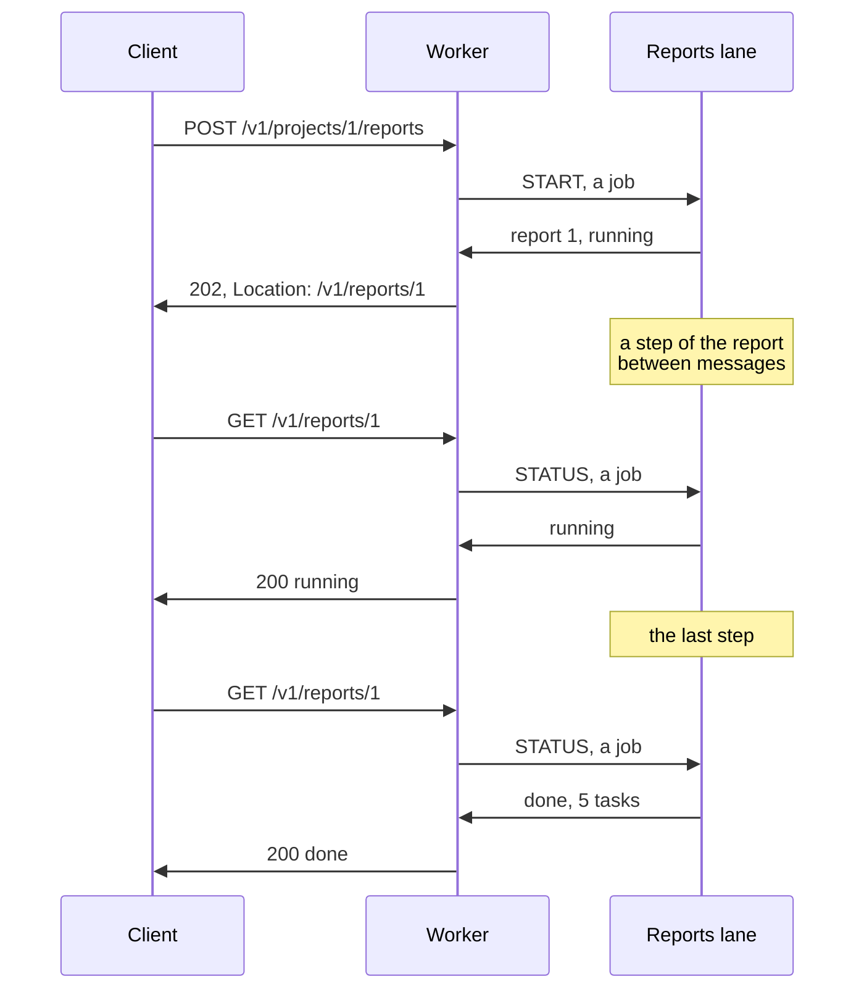

# 13. Limits

Every wait is bounded: a route waits up to a time limit, a lane's box holds a fixed
number of jobs, and a worker holds a fixed number of waiting routes. This page shows
what the client gets at each limit, and what the lane does when a client
stops waiting. The [goose-http limits guide](https://github.com/kaitk/goose-http/blob/main/docs/patterns.md#limits)
explains the event loop's side: its bounds, slow clients, and the resources a wait holds.

[`13-limits`](13-limits/main.goose) requests a project's summary from the database. The
`ms` parameter adds that many milliseconds, as a slow query would. The route waits
at most 200 ms, and the database lane's box holds two jobs:

```rust
// The longest a route waits for the database, in milliseconds.
let WAIT_MS: i64 = 200;
```

```rust
    // Two slots, the fewest a box has: two jobs waiting behind the one the
    // database works on fill it.
    let dbox, e = http::mail_open(2, 256);
```

## 504 for a late reply

The last argument to `rest::ask` is the time limit, which defaults to 5 seconds. When
the time is up, the route answers 504 `timeout` and the worker drops the reply
when it arrives:

```rust
        rest::ask(cx, cx.app.db, SUMMARY, job, Waiting.Summary, WAIT_MS);
```

```text
GET /v1/projects/1/summary?ms=500 504 {"error":"timeout"}
```

A job can't be stopped from outside. The database goes on with the 500 ms query, but no
route is waiting for its reply.

## 503 for a full box

While the database runs one job, the next ones wait in its box. If the box is
full, the job isn't sent: `rest::ask` answers 503 `unavailable` at once,
rather than queue work the database won't reach in time:

```text
GET /v1/projects/1/summary?ms=500 504 {"error":"timeout"}
GET /v1/projects/1/summary 000                              gave up, its job waiting
GET /v1/projects/1/summary 000                              gave up, its job waiting
GET /v1/projects/1/summary 503 {"error":"unavailable"}
```

Size a box for the jobs a lane can finish within the routes' time limit: more slots
only queue work whose clients get 504 before it starts. For more work at once, give the
lane several threads, each with its own box.

A lane of several threads opens with `rest::lane_open`, and `rest::ask` to it sends
each job to its least busy thread, with 503 only when every thread's box is full. The
best practices build one ([Lanes of several threads](../best-practices/lanes.md#66-lanes-of-several-threads)).

*Note: the best practices size each box by how long its lane's jobs take, and give work
the product can do without under load, such as reports, a small box of its own, so that
it's refused first ([How many jobs a box holds](../best-practices/lanes.md#62-how-many-jobs-a-box-holds)).*

## A client that has gone

A client can stop waiting while its job is queued or running: its connection closes,
or its wait times out. `rest::still_wanted(a)` says whether the route is still waiting,
so the lane skips a job nobody waits for. `rest::reply_value` returns false once
the route has gone:

```rust
        if tag == SUMMARY {
            let a, ok = rest::asked<SummaryJob>(bytes);
            if ok && !rest::still_wanted(a) {
                gone.skipped++;
            } else if ok {
                if a.job.ms > 0 { sleep_ms(a.job.ms); }
                let ts = db::fetch_all<db::Task>(c, "SELECT * FROM tasks WHERE project = $1 ORDER BY id", [a.job.project]);
                // False once the client has gone, as after its 504.
                if !rest::reply_value(a, Summary { project: a.job.project, tasks: ts.len }) { gone.dropped++; }
            }
```

The jobs for the two clients that gave up were skipped, and the reply to the route
that answered 504 was dropped:

```text
GET /v1/gone 200 {"skipped":2,"dropped":1}
```

`rest::still_wanted` is a snapshot: the client can stop waiting before the reply is sent.
A long job checks it between steps as well as before starting.

## A slow client

A route needs nothing for a client that reads its response slowly: goose-http bounds
it. Its loop stops reading from a connection whose responses queue up, and closes one
that takes nothing for `Config.write_ms`
([goose-http's limits](https://github.com/kaitk/goose-http/blob/main/docs/patterns.md#limits)).

## Background tasks

A wait holds the connection, a timer, and a slot of `Config.max_waiting`
([goose-http's slow work](https://github.com/kaitk/goose-http/blob/main/docs/patterns.md#slow-work)),
so a report that takes minutes doesn't fit one. It runs as a *background task*: the
route answers 202 at once, with where to ask, and the client polls until the report is
done. A background task is made of jobs, each a short wait: one starts the report, and
one for each poll reads its state. The reports lane keeps each report's state, and
advances the running report a step between its messages, so that it answers a poll
while a report runs:



The report's state is what a poll answers:

```rust
// A report's state, as GET /v1/reports/:id answers it.
struct Report { status: i32 = 200, code: u8[..32] = "", id: i64 = 0, project: i64 = 0, left: i64 = STEPS, tasks: i64 = 0 }
```

The job that starts the report replies with its state, and the case function answers
it with 202 and a `Location` to poll:

```rust
// The report has started: 202, and where to ask about it.
fn resume(w: Waiting.Started, cx) {
    let r, ok = rest::read_reply<Report>(cx);
    guard ok else { rest::fail(cx, 502, "bad_reply"); }
    var body: u8[>..] = [];
    format(body, r);
    http::start(cx.out, 202);
    http::field(cx.out, "Location", str("/v1/reports/", r.id));
    http::finish(cx.out, http::JSON, body);
}
```

```text
POST /v1/projects/1/reports 202 {"id":1,"project":1,"state":"running"}
GET /v1/reports/1 200 {"id":1,"project":1,"state":"running"}
GET /v1/reports/1 200 {"id":1,"project":1,"state":"done","tasks":5}
```

<details>
<summary>The routes, and the reports lane's thread</summary>

From [`main.goose`](13-limits/main.goose):

```rust
    } else if rest::on(cx, "POST", "/projects/:id/reports") {
        rest::ask(cx, cx.app.reports, START, StartJob { project: rest::param_int(cx, "id") }, Waiting.Started);
    } else if rest::on(cx, "GET", "/reports/:id") {
        rest::ask(cx, cx.app.reports, STATUS, StatusJob { id: rest::param_int(cx, "id") }, Waiting.Report);
```

The thread waits for mail at most a step's time while a report runs, answers what came,
and then takes a step. `rest::lane` waits with no time limit, so this thread writes its
own loop, which ends as `rest::lane`'s does: once `http::mail_stopped` finds the box
stopped by `main` and empty:

```rust
// The reports' thread: it takes a step of the report running between its
// messages, so that it replies to a client's question while a report runs.
// Its wait has a time limit while a report runs, so it writes the loop that
// rest::lane is, until the box is stopped and empty.
thread_fn reports(box: http::Box) {
    var c = db::open(DELAY_MS);
    var all: Report[>..] = [];
    while !http::mail_stopped(box) {
        var busy = false;
        for r in all { if r.left > 0 { busy = true; } }
        http::mail_wait(box, if busy { STEP_MS } else { 1000 });
        http::mail_take(box) { key, tag, bytes =>
            if tag == START {
                let a, ok = rest::asked<StartJob>(bytes);
                if ok {
                    let r .= all.push(Report { id: all.len + 1, project: a.job.project, .. });
                    rest::reply_value(a, r);
                }
            } else if tag == STATUS {
                let a, ok = rest::asked<StatusJob>(bytes);
                if ok && a.job.id >= 1 && a.job.id <= all.len {
                    rest::reply_value(a, all[a.job.id - 1]);
                } else if ok {
                    rest::reply_value(a, Report { status: 404, code: "report_not_found", .. });
                }
            }
        };
        for &r in all {
            if r.left > 0 {
                r.left--;
                if r.left == 0 {
                    let ts = db::fetch_all<db::Task>(c, "SELECT * FROM tasks WHERE project = $1 ORDER BY id", [r.project]);
                    r.tasks = ts.len;
                }
                break;
            }
        }
    }
    http::mail_close(box);
}
```

</details>

These reports live in the lane's memory and are lost when the server stops. Reports
that clients must find after a restart belong in the database.

---

[Index](README.md) · Previous: [12. Two lanes, or a reply in pieces](12-two-lanes.md)
· Next: [14. Bodies read as they arrive](14-bodies-in-pieces.md)
