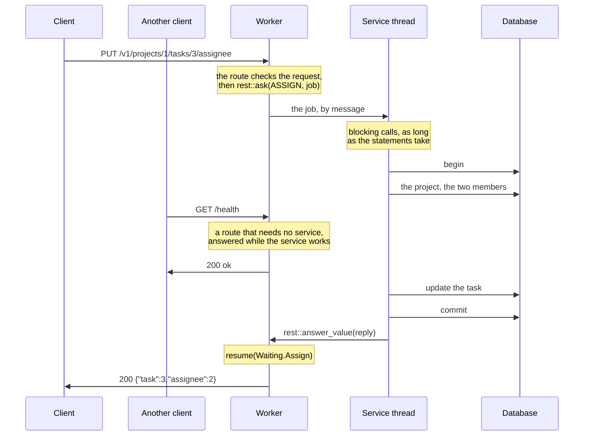

# 13. Work that waits

The projects move into a database. Its driver blocks: a query sends a statement, and the
call returns when the rows come back. This page runs the queries first in the route,
then on a service thread that owns the connection, and shows why the second is the one
to use.

The database here is the tutorial's own [`db`](db/db.goose): rows in memory, read and
written by the statements the pages run, each of which sleeps 20 ms as a query over a
network would. Its calls read like a Rust driver's, such as sqlx's: a connection, a
statement with bound parameters, and rows read into structs. A real driver can take its
place without changing the pages.

## In the route

A query that takes microseconds, such as one on an embedded SQLite database, can run in
the route. From [`13-waiting`](13-waiting/app.goose):

```rust
    if rest::on(cx, "GET", "/in-place/projects/:id") {
        // Blocks the worker, and every connection it holds, for the query.
        let id = rest::param_int(cx, "id");
        let p, found = db::fetch_one<db::Project>(cx.app.conn, "SELECT * FROM projects WHERE id = $1", [id]);
        guard found else { rest::fail(cx, 404, "project_not_found"); }
        rest::json(cx, 200, project_of(p));
```

A worker is one thread that serves thousands of connections, one call at a time, so
while this query waits, every other connection on the worker waits too: 20 ms here,
for each of them. A worker also has its own copy of the program's state, so each worker
needs a connection of its own, and none can see another's transaction.

## Behind a service

Work that waits goes to a thread of the program's own, a *service*, which owns the
connections. A route sends it one job by message, and returns; the worker serves its
other connections, and calls the handler again when the reply comes:



The worker never blocks on the database, so the service can take its time. It's a
thread that does nothing else, and its calls block as long as the statements take: a
slow query holds up only the jobs queued behind it, not the worker's connections. What
bounds it is the route's side, how long the route waits and how many jobs its box
holds ([Limits](15-limits.md)).
goose-http's [slow work](https://github.com/kaitk/goose-http/blob/main/docs/patterns.md#slow-work)
shows the same exchange at the loop's level, with its time limit, and
[mail between threads](https://github.com/kaitk/goose-http/blob/main/docs/patterns.md#mail-between-threads)
how messages cross.

The job names a whole use case, and the service does it start to end, with plain
blocking calls, as an Axum or Express handler's body would. Assigning a task checks the
project, that the user asking is a member, and that the assignee is one, then updates
the task: four statements in one transaction. From
[`service.goose`](13-waiting/service.goose):

```rust
// Assigns a task, for a user who is a member of its project, to another
// member: four statements in one transaction.
fn assign(c: db::Conn&, j: AssignJob) -> AssignReply {
    db::begin(c);

    // The project exists.
    let p, found = db::fetch_one<db::Project>(c, "SELECT * FROM projects WHERE id = $1", [j.project]);
    guard found else { db::rollback(c); return AssignReply { status: 404, code: "project_not_found" }; }

    // The user asking is one of its members, and so is the assignee.
    let m, member = db::fetch_one<db::Member>(c, "SELECT * FROM members WHERE project = $1 AND user = $2", [j.project, j.user]);
    guard member else { db::rollback(c); return AssignReply { status: 403, code: "not_a_member" }; }
    let a, assignable = db::fetch_one<db::Member>(c, "SELECT * FROM members WHERE project = $1 AND user = $2", [j.project, j.assignee]);
    guard assignable else { db::rollback(c); return AssignReply { status: 409, code: "assignee_not_a_member" }; }

    // The task is in the project: the update changes one row, or none.
    let n = db::execute(c, "UPDATE tasks SET assignee = $1 WHERE id = $2 AND project = $3", [j.assignee, j.task, j.project]);
    guard n == 1 else { db::rollback(c); return AssignReply { status: 404, code: "task_not_found" }; }

    db::commit(c);
    return AssignReply { .. };
}
```

A reply that carries an error's status and code lets the route answer it in the one
error shape. The job and its reply are flat structs: they cross between threads as
bytes, in messages of `Config.mail_size` bytes, 256 by default.

```rust
struct AssignJob { project: i64, task: i64, user: i64, assignee: i64 }
struct AssignReply { status: i32 = 200, code: u8[..32] = "" }
```

The service's thread takes each job from its box with `rest::asked<J>`, and answers
with `rest::answer_value`:

```rust
            } else if tag == ASSIGN {
                let a, ok = rest::asked<AssignJob>(bytes);
                if ok { rest::answer_value(a, assign(c, a.job)); }
```

## The route asks, and resumes

The route reads and checks the request, then asks once with `rest::ask`: the service's
address, the job's tag, the job, and what the route needs when the reply comes. From
[`app.goose`](13-waiting/app.goose), which holds the routes apart from `main` so that
a test can import them:

```rust
    } else if rest::on(cx, "PUT", "/projects/:id/tasks/:task/assignee") {
        let user, has_user = rest::header(cx, "X-User");
        rest::require(cx, "X-User", has_user);
        let assignee, has_assignee = rest::query_int(cx, "user");
        rest::require(cx, "user", has_assignee);
        let job = service::AssignJob {
            project: rest::param_int(cx, "id"), task: rest::param_int(cx, "task"),
            user: rest::int_of(cx, user, "X-User"), assignee: assignee,
        };
        rest::ask(cx, cx.app.db, service::ASSIGN, job, Waiting.Assign { task: job.task, assignee: assignee });
```

Goose has no `async`, and can't keep a closure to call later, so what the route needs
when it resumes goes in a variant of the program's `Waiting` enum, which `rest::ask`
keeps in the request's state:

```rust
// What each route that waits needs when its reply comes.
enum Waiting {
    None,
    Project,
    Assign { task: i64, assignee: i64 },
}

struct St { waiting: Waiting = Waiting.None }
```

When the reply comes, the handler runs again, and `rest::woken` sends it to a case
function per variant, `resume`. The compiler checks that every variant has one:

```rust
    let e = rest::serve(cfg, app, St { .. }) { cx =>
        if rest::woken(cx) {
            rest::route(cx) { resume(cx.state.waiting, cx); };
        } else {
            handle(cx);
        }
    };
```

```rust
fn resume(w: Waiting.Assign, cx) {
    let r, ok = rest::reply_value<service::AssignReply>(cx);
    guard ok else { rest::fail(cx, 502, "bad_reply"); }
    guard r.status < 400 else { rest::fail(cx, r.status, r.code); }
    rest::json(cx, 200, Assigned { task: w.task, assignee: w.assignee });
}
```

```text
PUT /v1/projects/1/tasks/3/assignee?user=2 200 {"task":3,"assignee":2}
PUT /v1/projects/9/tasks/3/assignee?user=2 404 {"error":"project_not_found"}
PUT /v1/projects/1/tasks/3/assignee?user=2 403 {"error":"not_a_member"}
PUT /v1/projects/1/tasks/3/assignee?user=3 409 {"error":"assignee_not_a_member"}
PUT /v1/projects/1/tasks/6/assignee?user=2 404 {"error":"task_not_found"}
```

`main` opens the service's box, starts its thread, and turns waiting on, which is off
until `Config.mail_slots` and `max_waiting` are set:

```rust
    let box, e = http::mail_open(64, 256);
    http::exit_on_error(e);
    let to = http::address(box, 0);
    let st = thread_spawn(service::run, box, DELAY_MS);
    let cfg = http::Config { port: port as i32, workers: 1, mail_slots: 64, max_waiting: 1024, .. };
```

## Why one job per route

A route could instead ask once per query, and resume after each: a state machine with
a `Waiting` variant and a case function per query. One job per route is the default,
because:

- A use case reads as one function, next to its data, and its queries share one
  transaction. A route that waits once per query can't hold a transaction across its
  waits without tying a connection to a request.
- Each route waits once: one `Waiting` variant, one time limit, and one place where a
  full box refuses work ([Limits](15-limits.md)).
- A use case is tested as a plain call on a job, without a request or threads, as
  [`test.goose`](13-waiting/test.goose) does ([Testing the application](16-testing.md)
  covers the routes too):

```rust
    var c = db::open(0);
    expect(service::assign(c, service::AssignJob { project: 1, task: 3, user: 1, assignee: 2 }), 200, "");
    assert(assignee(c, 3) == 2);
```

What it costs: the job and its reply cross as flat values, the HTTP layer and the use
cases live in different functions, and a check that needs the database before the
route, such as a session looked up by its cookie, goes in the job, so that the route
still waits once. A route that waits on two services in turn needs more than one wait:
[the next page](14-two-services.md).

---

[Index](README.md) · Previous: [10. Large bodies](10-large-bodies.md) · Next:
[14. Two services, or a reply in pieces](14-two-services.md)
