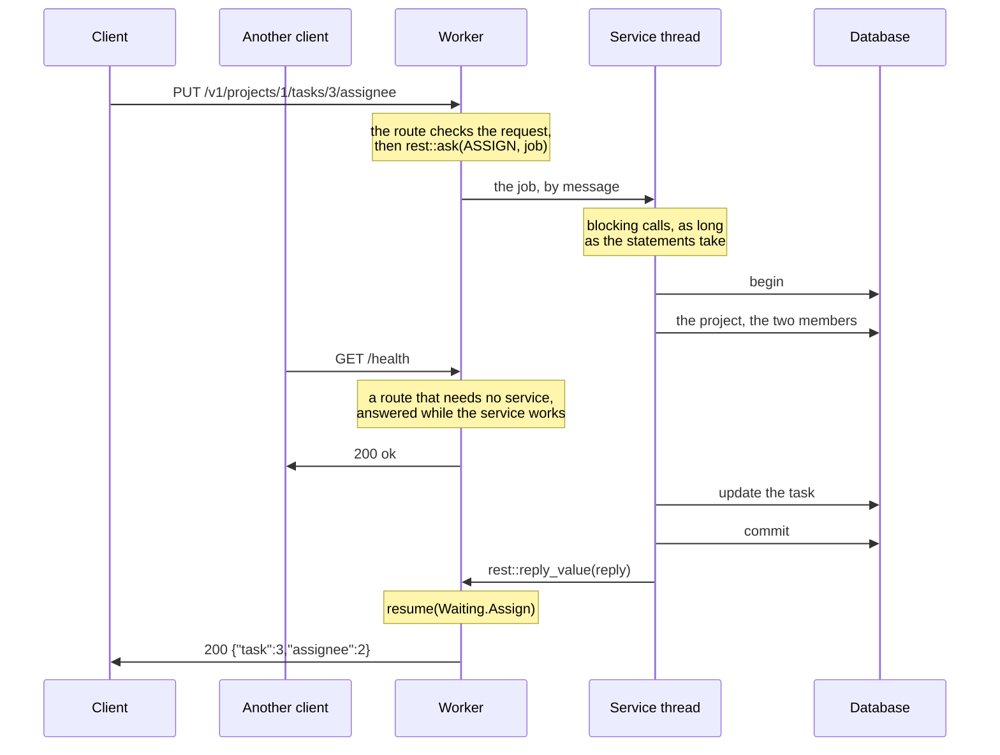

# 13. Work that waits

The projects now move into a database. Its driver blocks: a query sends a statement,
and the call returns when the rows come back. This page first runs queries in the route,
then moves them to a service thread that owns the connection, showing why the service
thread is the recommended approach.

The database here is the tutorial's own [`db`](db/db.goose): in-memory rows read and
written by the statements used in these pages. Each statement sleeps for 20 ms to
simulate a query over a network. Its calls resemble those of a Rust driver such as
sqlx: a connection, a statement with bound parameters, and rows read into structs.
A real driver can replace it without changing the pages.

## In the route

A query that takes microseconds, such as one on an embedded SQLite database, can run in
the route. From [`13-waiting`](13-waiting/app.goose):

```rust
    if rest::on(cx, "GET", "/in-place/projects/:id") {
        // Blocks the worker, and every connection it holds, for the query.
        let id = rest::param_int(cx, "id");
        let p, found = db::fetch_one<db::Project>(cx.app.conn, "SELECT * FROM projects WHERE id = $1", [id]);
        guard found else { rest::fail(cx, 404, "project_not_found"); }
        rest::json(cx, 200, project_of(p));
```

A worker is a single thread serving thousands of connections, one call at a time.
While this query waits, every other connection on the worker waits too: 20 ms here for
each connection. Each worker also has its own copy of the program's state, so it needs
its own database connection and cannot see another worker's transaction.

## Behind a service

Work that waits goes to a dedicated thread in the program: a *service* that owns the
database connections. A route sends it a job by message and returns. The worker serves
its other connections, then calls the handler again when the reply arrives:



The worker never blocks on the database. The service thread does nothing else, and its
calls block for as long as the statements take: a slow query holds up only the jobs
queued behind it, not the worker's connections. The limits apply on the route's side:
how long the route waits and how many jobs the service's box holds ([Limits](15-limits.md)).
goose-http's [slow work](https://github.com/kaitk/goose-http/blob/main/docs/patterns.md#slow-work)
shows the same exchange at the loop's level, with its time limit, and
[mail between threads](https://github.com/kaitk/goose-http/blob/main/docs/patterns.md#mail-between-threads)
explains how messages cross between threads.

The job represents a complete use case, which the service performs from start to finish
with plain blocking calls, as the body of an Axum or Express handler would. Assigning
a task checks that the project exists and that both the requesting user and the
assignee are members, then updates the task: four statements in one transaction. From
[`service.goose`](13-waiting/service.goose):

```rust
// Assigns a task, for a user who is a member of its project, to another
// member: four statements in one transaction.
fn assign(c: db::Conn&, j: AssignJob) -> AssignReply {
    db::begin(c);

    // The project exists.
    let p, found = db::fetch_one<db::Project>(c, "SELECT * FROM projects WHERE id = $1", [j.project]);
    guard found else { db::rollback(c); return AssignReply { status: 404, code: "project_not_found" }; }

    // The user asking is one of its members, and so is the assignee.
    let m, member = db::fetch_one<db::Member>(c, "SELECT * FROM members WHERE project = $1 AND user = $2", [j.project, j.user]);
    guard member else { db::rollback(c); return AssignReply { status: 403, code: "not_a_member" }; }
    let a, assignable = db::fetch_one<db::Member>(c, "SELECT * FROM members WHERE project = $1 AND user = $2", [j.project, j.assignee]);
    guard assignable else { db::rollback(c); return AssignReply { status: 409, code: "assignee_not_a_member" }; }

    // The task is in the project: the update changes one row, or none.
    let n = db::execute(c, "UPDATE tasks SET assignee = $1 WHERE id = $2 AND project = $3", [j.assignee, j.task, j.project]);
    guard n == 1 else { db::rollback(c); return AssignReply { status: 404, code: "task_not_found" }; }

    db::commit(c);
    return AssignReply { .. };
}
```

A reply that carries an error's status and code lets the route answer it in the one
error shape. The job and its reply are flat structs passed between threads as
bytes, in messages of `Config.mail_size` bytes, 256 by default.

```rust
struct AssignJob { project: i64, task: i64, user: i64, assignee: i64 }
struct AssignReply { status: i32 = 200, code: u8[..32] = "" }
```

The service's thread takes each job from its box with `rest::asked<J>`, and replies
with `rest::reply_value`:

```rust
            } else if tag == ASSIGN {
                let a, ok = rest::asked<AssignJob>(bytes);
                if ok { rest::reply_value(a, assign(c, a.job)); }
```

## The route asks, and resumes

The route reads and validates the request, then calls `rest::ask` once, passing the
service address, the job tag, the job, and the state needed when the reply arrives. From
[`app.goose`](13-waiting/app.goose), which holds the routes apart from `main` so that
a test can import them:

```rust
    } else if rest::on(cx, "PUT", "/projects/:id/tasks/:task/assignee") {
        let user, has_user = rest::header(cx, "X-User");
        rest::require(cx, "X-User", has_user);
        let assignee, has_assignee = rest::query_int(cx, "user");
        rest::require(cx, "user", has_assignee);
        let job = service::AssignJob {
            project: rest::param_int(cx, "id"), task: rest::param_int(cx, "task"),
            user: rest::int_of(cx, user, "X-User"), assignee: assignee,
        };
        rest::ask(cx, cx.app.db, service::ASSIGN, job, Waiting.Assign { task: job.task, assignee: assignee });
```

Goose has no `async` and can't store a closure to call later. Instead, the state the
route needs when it resumes goes in a variant of the program's `Waiting` enum.
`rest::ask` stores this in the request state:

```rust
// What each route that waits needs when its reply comes.
enum Waiting {
    None,
    Project,
    Assign { task: i64, assignee: i64 },
}

struct St { waiting: Waiting = Waiting.None }
```

When the reply comes, the handler runs again, and `rest::resumed`, true for every call
after the request's first, sends it to a case function per variant, `resume`. The
compiler checks that every variant has one:

```rust
    let e = rest::serve(cfg, app, St { .. }) { cx =>
        if rest::resumed(cx) {
            rest::route(cx) { resume(cx.state.waiting, cx); };
        } else {
            handle(cx);
        }
    };
```

```rust
fn resume(w: Waiting.Assign, cx) {
    let r, ok = rest::read_reply<service::AssignReply>(cx);
    guard ok else { rest::fail(cx, 502, "bad_reply"); }
    guard r.status < 400 else { rest::fail(cx, r.status, r.code); }
    rest::json(cx, 200, Assigned { task: w.task, assignee: w.assignee });
}
```

```text
PUT /v1/projects/1/tasks/3/assignee?user=2 200 {"task":3,"assignee":2}
PUT /v1/projects/9/tasks/3/assignee?user=2 404 {"error":"project_not_found"}
PUT /v1/projects/1/tasks/3/assignee?user=2 403 {"error":"not_a_member"}
PUT /v1/projects/1/tasks/3/assignee?user=3 409 {"error":"assignee_not_a_member"}
PUT /v1/projects/1/tasks/6/assignee?user=2 404 {"error":"task_not_found"}
```

`main` opens the service's mailbox, starts its thread, and enables waiting. Waiting is
disabled until `Config.mail_slots` and `max_waiting` are set:

```rust
    let box, e = http::mail_open(64, 256);
    http::exit_on_error(e);
    let to = http::address(box, 0);
    let st = thread_spawn(service::run, box, DELAY_MS);
    let cfg = http::Config { port: port as i32, workers: 1, mail_slots: 64, max_waiting: 1024, .. };
```

## Why one job per route

A route could instead ask once per query, and resume after each: a state machine with
a `Waiting` variant and a case function per query. One job per route is the default,
because:

- A use case reads as one function, next to its data, and its queries share one
  transaction. A route that waits once per query can't hold a transaction across its
  waits without tying a connection to a request.
- Each route waits once: one `Waiting` variant, one time limit, and one place where a
  full box refuses work ([Limits](15-limits.md)).
- A use case is tested as a plain call on a job, without a request or threads, as
  [`test.goose`](13-waiting/test.goose) does ([Testing the application](16-testing.md)
  covers the routes too):

```rust
    var c = db::open(0);
    expect(service::assign(c, service::AssignJob { project: 1, task: 3, user: 1, assignee: 2 }), 200, "");
    assert(assignee(c, 3) == 2);
```

The trade-offs are that jobs and replies must cross thread boundaries as flat values,
and the HTTP layer and use cases live in separate functions. Checks that need the
database before the route's work, such as looking up a session by its cookie, go in the
job so the route still waits only once. A route using two services in sequence needs
more than one wait: [the next page](14-two-services.md).

---

[Index](README.md) · Previous: [12. Long responses and files](12-long-responses.md) · Next:
[14. Two services, or a reply in pieces](14-two-services.md)
