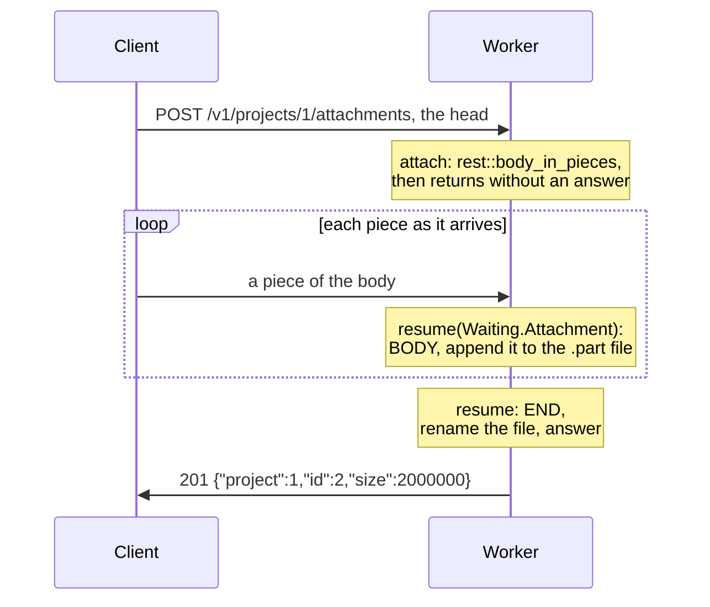

# 14. Bodies read as they arrive

Projects now have attachments: photos, scans, and exports, up to 1 GB each. A body that
large won't fit in a worker's memory, and the worker holds every body it gathers until
its route returns ([page 10](10-large-bodies.md)). Instead, the route reads an
attachment in pieces as it arrives, writing each piece to a file before the next
comes. The worker holds one piece at a time, however large the attachment. The
pieces come to the route's case function, as a lane's reply does on
[page 11](11-waiting.md). [goose-http's request bodies](https://github.com/kaitk/goose-http/blob/main/docs/patterns.md#request-bodies)
covers how goose-http reads a body this way.

## A body read in pieces

`rest::body_in_pieces(cx, limit, w)` takes the body in pieces, up to `limit` bytes. Like
`rest::ask`, it keeps a `Waiting` variant in the request's state, `w`, and the route
returns without an answer. From
[`14-bodies-in-pieces`](14-bodies-in-pieces/main.goose):

```rust
// POST /v1/projects/:id/attachments: any size up to the project's limit,
// written a piece at a time.
fn attach(cx, project: i64) {
    let id = cx.app.next;
    // Returns at once, reading nothing; the pieces come to resume(Waiting.Attachment).
    rest::body_in_pieces(cx, limit_of(project), Waiting.Attachment { project: project, id: id });
    // Accepted: take the id, and name the file the pieces go to.
    cx.app.next++;
    cx.state.part_path = str(cx.app.dir, "/", project, "-", id, ".part");
}
```

`rest::body_in_pieces` doesn't read the body itself. It accepts or refuses the body and
sets where its pieces go. A `Content-Length` over the limit gets 413, which leaves the
route at the call. The code before and after the call runs once: unlike `rest::body`, it
leaves the route only if it refuses the body. No piece arrives before the route returns,
even if the body came with its head. After the call, the route can still set the state
it needs for the pieces, such as `part_path` here.

<details>
<summary>The routes, which check the project first</summary>

```rust
        } else if rest::on(cx, "POST", "/v1/projects/:id/attachments") {
            rest::route(cx) { attach(cx, project(cx)); };
        } else if rest::on(cx, "POST", "/v1/projects/:id/attachments/form") {
            rest::route(cx) { attach_form(cx, project(cx)); };
```

```rust
fn project(cx) -> i64 {
    let id = rest::param_int(cx, "id");
    guard id >= 1 && id <= PROJECTS else { rest::fail(cx, 404, "project_not_found"); }
    return id;
}

fn limit_of(project: i64) -> i64 { if project == 1 { LARGE_LIMIT } else { SMALL_LIMIT } }
```

</details>

The handler is then called again for each piece of the body, through the same
`rest::resumed` block as a lane's reply
([page 11](11-waiting.md#asking-a-lane-and-resuming)), and goes to the variant's case
function. `cx.kind` says which event it is: `http::BODY` with a piece in `cx.body`,
`http::END` once the whole body has arrived, or `http::CLOSED`:



```rust
fn resume(w: Waiting.Attachment, cx) {
    if cx.kind == http::BODY {
        store(cx, cx.body);
        guard cx.state.stored else { rest::fail(cx, 500, "not_stored"); }
    } else if cx.kind == http::END {
        keep(cx, w.project, w.id, "");
    } else if cx.kind == http::CLOSED {
        // The client went, the body passed its limit, or the route failed.
        delete_file(cx.state.part_path);
    }
}
```

Each piece is appended to a `.part` file. At the `END`, the file is renamed to its own
name and the route answers 201:

```rust
// Appends bytes to the attachment's .part file, and counts them.
fn store(cx, bytes: const u8[:]) {
    if bytes.len > 0 && !append_file(cx.state.part_path, bytes) { cx.state.stored = false; }
    cx.state.size += bytes.len;
}
```

Values the route keeps between pieces go in the request state, which starts fresh for
each request: the file's path and the number of bytes received so far. Values that don't
change, such as the project, go in the variant:

```rust
// What each route that reads its body in pieces needs at each call.
enum Waiting {
    None,
    Attachment { project: i64, id: i64 },
    Form { project: i64, id: i64 },
}
```

A body that fits alongside its head in the read buffer comes as one `BODY` and the
`END`, so the route handles every size the same way:

```text
POST /v1/projects/1/attachments 201 {"project":1,"id":1,"size":19}         whole, as one piece
POST /v1/projects/1/attachments 201 {"project":1,"id":2,"size":2000000}    2 MB, in pieces
POST /v1/projects/9/attachments 404 {"error":"project_not_found"}         not read
```

The project is checked before `rest::body_in_pieces`, so an attachment to one that doesn't
exist gets its 404 before any of the body is read.

## Limits, and ending early

Each project's plan sets its limit: project 1 takes up to 1 GB, project 2 up to 64 KB.

```rust
// The most bytes of an attachment: project 1's plan takes up to 1 GB, which
// no worker could hold whole, and project 2's up to 64 KB.
let LARGE_LIMIT: i64 = 1 << 30;
let SMALL_LIMIT: i64 = 64 * 1024;
```

A body whose `Content-Length` is over the limit fails at `rest::body_in_pieces` with
413, before the client sends it. A chunked body has no declared length, so goose-rest
counts its bytes as they arrive. If it passes the limit, goose-rest answers 413 and
closes the connection. `http::Config`'s `max_body` still caps every route, so `main`
raises it to the largest limit, as
[page 10](10-large-bodies.md#body-limits-and-the-gather-budget) explains:

```rust
    let cfg = http::Config { port: port as i32, workers: 1, max_body: LARGE_LIMIT, .. };
```

If reading stops before `END`, the case function gets `http::CLOSED` once. It then
frees what the state holds: here, the `.part` file. This happens when:

- the client disconnects before the whole body arrives;
- a chunked body passes the limit;
- the route fails while handling a piece, such as when the disk is full, or answers
  before the `END`.

After `CLOSED`, the route gets no more pieces. If it fails while handling a piece, it
answers at once in the error shape, and goose-http drops the rest of the body. A route
that answers at `END`, as here, gets no `CLOSED`. A check that fails there must therefore
clean up first, as the form below does.

```text
POST /v1/projects/2/attachments 413 {"error":"payload_too_large"}   100 KB, from its Content-Length
POST /v1/projects/2/attachments 413 {"error":"payload_too_large"}   100 KB chunked, past 64 KB
POST /v1/projects/1/attachments 000                                 the client gives up after a second
files: 1-1 1-2                                                      its .part file is gone
```

## A multipart form

A browser uploads a file with a form: `multipart/form-data`, its fields and files in
parts. goose-http's `http::each_part` reads a multipart form a piece at a time, with an
`http::Multipart` in the state that holds what a piece leaves unfinished. The route
starts it, or answers 415 for a body of another type:

```rust
    guard http::start_multipart(cx.req, cx.state.form) else { rest::fail(cx, 415, "unsupported_media_type"); }
```

Each piece then goes through `each_part`, which calls its block with each part's head,
the pieces of its content, and its end. The note's content goes in the state, and the
uploaded file's content goes in its `.part` file:

```rust
fn resume(w: Waiting.Form, cx) {
    if cx.kind == http::BODY {
        // A piece can end one part and start the next, or stop mid-head:
        // each_part calls the block for what the piece completes, and keeps
        // the rest in cx.state.form for the next piece.
        let ok = http::each_part(cx.state.form, cx.body) { part =>
            match part {
                // A part begins: note it's the note, the file, or another.
                Head h => form_part(cx, h.fields),
                // Some of its content: the file's to disk, the note's to the
                // state, up to 128 bytes.
                Data d => {
                    if cx.state.part == FILE { store(cx, d.bytes); }
                    else if cx.state.part == NOTE { cx.state.note.append(d.bytes[..min(d.bytes.len, 128 - cx.state.note.len)]); }
                },
                End => { cx.state.part = NO_PART; },
            }
        };
        guard ok else { rest::fail(cx, 400, "invalid_multipart"); }
        guard cx.state.stored else { rest::fail(cx, 500, "not_stored"); }
    } else if cx.kind == http::END {
        // The body has all come; a form cut short lacks its closing boundary.
        guard http::multipart_done(cx.state.form) else {
            delete_file(cx.state.part_path);
            rest::fail(cx, 400, "invalid_multipart");
        }
        keep(cx, w.project, w.id, cx.state.note);
    } else if cx.kind == http::CLOSED {
        delete_file(cx.state.part_path);
    }
}
```

```text
POST /v1/projects/1/attachments/form 201 {"project":1,"id":5,"size":30000,"note":"Floor plans"}
POST /v1/projects/1/attachments/form 415 {"error":"unsupported_media_type"}
POST /v1/projects/1/attachments/form 400 {"error":"invalid_multipart"}
```

The `http::Multipart` is in the request state, so every connection holds its 2 KB,
whichever route it's on
([goose-http's helpers](https://github.com/kaitk/goose-http/blob/main/docs/api.md#helpers-for-apis)).

## Middleware on later calls

This program uses no middleware. In one that wraps `handle` in `rest::cors` and
`rest::timed`, as [page 7](07-middleware.md)'s does, they run when the request comes,
and not around `resume`. A route that calls `rest::body_in_pieces` returns before its answer,
so each middleware keeps what it decided with the exchange: the allowed origin's fields,
and the time the request came. The answer `resume` writes at the `END` gets the same
CORS fields and a `Server-Timing` measured from the request, as does a 413 for a body
past its limit. A browser that uploads from another origin reads that answer as it
reads one written in the route. An answer to a lane's reply gets them the same way
([reference](../reference.md#middleware)).

---

[Index](README.md) · Previous: [13. Limits](13-limits.md) · Next:
[15. Long responses and files](15-long-responses.md)
